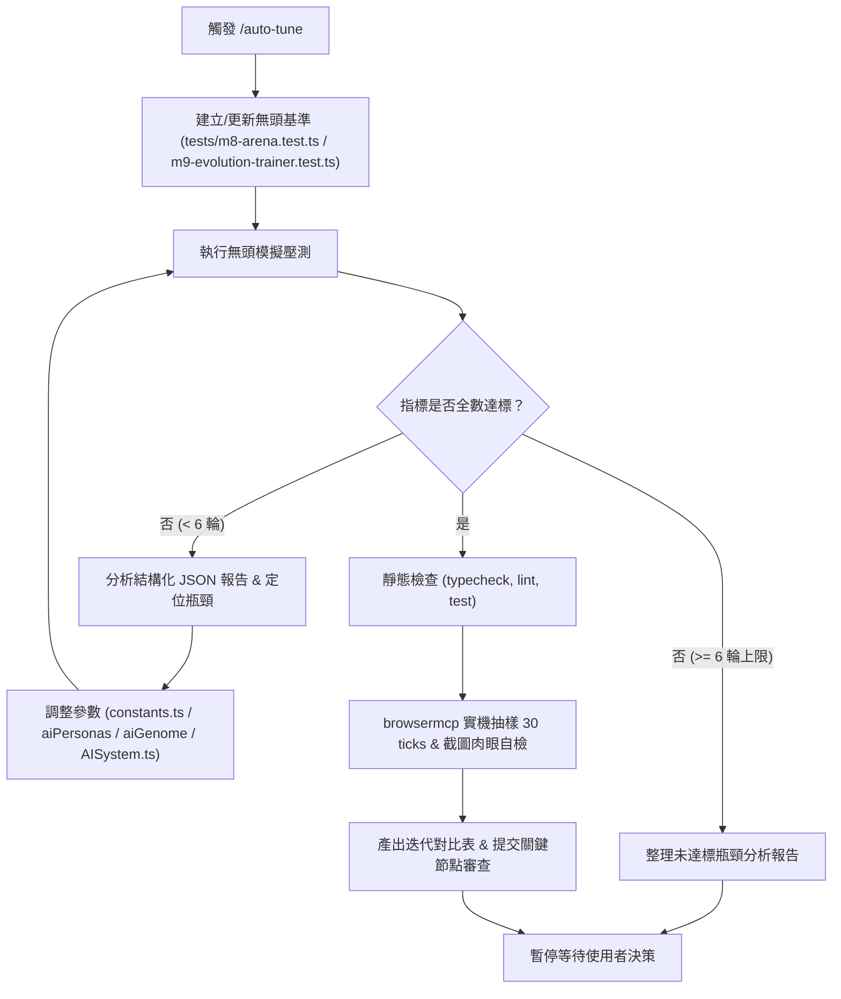

# 自主迭代調優規範 (Autonomous Tuning Skill)

用法：在聊天輸入 `/auto-tune` 或要求自主調優 AI 決策、子彈相消物理與手感參數時觸發。  
本 Skill 定義了全自動的「無頭模擬壓測 -> 數據分析 -> 參數微調 -> 瀏覽器實機抽樣驗證」閉環流程。在達到設定指標或 6 輪迭代上限前，Agent 享有完全自主權進行連續調整，無需每輪打擾使用者；完成後向使用者提交關鍵節點審查報告。

---

## 核心原則與紅線 (Core Principles & Guardrails)

1. **自主授權邊界 (Autonomous Boundary)**：
   - 在迭代次數 $\le 6$ 輪以內，當量化指標未達標時，Agent **不需詢問使用者**，直接分析數據、調整代碼/參數並再次驗證。
   - 僅在以下兩種情況停下來交由使用者審查：
     1. 所有量化指標全數達標，且通過瀏覽器實機抽樣與靜態檢查。
     2. 達到 6 輪迭代上限，輸出詳細診斷分析與當前最佳參數，等待使用者決策。
2. **單一真值與規範約束 (Single Truth & Code Standards)**：
   - 參數調整僅限於 `src/config/constants.ts`（具名常數）、`src/ai/aiPersonas.config.ts`、`src/ai/aiGenome.ts`、`src/ai/aiTactics.ts` 與 `src/ai/AISystem.ts`。嚴禁在熱路徑硬編碼魔術數字。
   - 不得破壞原版基礎設定；未查證之新數值常數必須保持具名並加上 `TODO(tune)` 標記。
   - 絕對禁止在熱路徑（`update` 迴圈、碰撞檢測）引入任何物件配置、閉包或禁用語法（Zero-GC 鐵則）。
3. **無退化原則 (Zero-Regression)**：
   - 調優過程必須保證全專案既有單元測試（`npm test`）、型別檢查（`npm run typecheck`）與 Biome Linter（`npm run lint`）完全通過。

---

## 自主調優迴圈規範 (Autonomous Tuning Loop)



---

### 第一階段：量化基準測試架構

包含兩大無頭評估工具：

1. **M8 小型決鬥與子彈相消基準 (`tests/m8-arena.test.ts`)**：
   - **`[BulletClash]` (子彈相消物理)**：
     - `basicClashRate`: Basic 對射時子彈互相碰撞抵消之比率（目標基準：8% ~ 18%）。
     - `destroyerPenetrationHpRatio`: Destroyer 巨彈突破多發一般子彈彈幕後的平均剩餘生命百分比（目標基準：40% ~ 75%）。
     - `zeroGcViolations`: 模擬過程中的暫態物件配置計數（目標基準：0）。
   - **`[AIDefense]` (AI 防禦與規避戰術)**：
     - `heavyBulletInterceptRate`: 面對高威脅巨彈/狙擊彈的主動迎擊攔截率（目標基準：> 35%）。
     - `flankEvasionSurvivalRate`: 遭遇致死彈道時側向閃避後的存活率（目標基準：> 55%）。
   - **`[AISmoothness]` (AI 移動與瞄準平滑度)**：
     - `movementJitterRate`: 移動向量方向瞬間反轉（> 120 度劇烈震盪）的頻率（目標基準：< 2.0 次 / 100 ticks）。
     - `aimJitterRate`: 瞄準向量瞬間角速度反轉震顫頻率（目標基準：< 1.5 次 / 100 ticks）。

2. **M9 自對弈演化訓練器 (`tests/m9-evolution-trainer.test.ts`)**：
   - **Stage A (微觀決鬥 Micro-Duels)**：固定種子下 4 大職業閉環決鬥，評估命中率、子彈碰撞與邊界越界。
   - **Stage B (宏觀混戰 Macro-FFA 2,000 Ticks)**：40 台包含 4 種人設的 AI 坦克進行大規模自由混戰，評估 KD 比率、PvP 傷害佔比與適應度分數 (`fitnessScore`，匯出至 `reports/m9-epoch-summary.json`)。
   - **避障與逃逸指標**：形狀碰撞率（目標趨近 0）、定向逃逸維持（75 ticks 穩定逃離威脅）、弱肉強食實力差距主動避退率（目標 100%）。

---

### 第二階段：自主迭代修改 (最多 6 輪迭代上限)

1. **執行測試並解析數據**：
   - 執行命令：`npx vitest run tests/m8-arena.test.ts tests/m9-evolution-trainer.test.ts`。
   - 讀取終端機輸出的 JSON 診斷指標，比對是否所有項均落入目標區間。
2. **自主分析歸因 (Root Cause Analysis)**：
   - **子彈太容易穿透或相消過弱**：微調 `constants.ts` 中的子彈相消消耗比率與彈道折射角度。
   - **AI 自撞幾何形狀**：調整 `AI_SHAPE_LOOKAHEAD_TICKS`（預設 10）與 `AI_SHAPE_TANGENT_FORCE`（預設 3.6）。
   - **弱小 AI 迎面送死**：微調 `aiPersonas.config.ts` 中的 `intimidationSensitivity` 或 `AI_INTIMIDATION_POWER_DIFF_THRESHOLD`（預設 15.0）。
   - **AI 轉向抽搐或移動抖動 (Jitter)**：調平 `AISystem.ts` 中的狀態機遲滯門檻（Hysteresis）、角速度上限或向量平滑權重。
3. **安全微調與記錄**：
   - 嚴格維持型別安全與 `TODO(tune)` 註解格式。
   - 記錄每輪調參的變更項、理論動機與調整後的測試數據。
   - 重複「測試 -> 分析 -> 調參」迴圈，直至全數達標或累計達 6 輪。

---

### 第三階段：靜態代碼與全量測試防護 (Quality Gate)

無頭指標達標後，執行防護檢查，確保無語法與功能退化：
1. **型別檢查**：`npm run typecheck`。
2. **靜態風格與 Linter**：`npm run lint`（Biome 檢查，確保零 `any`、無無效引用）。
3. **全專案單元測試**：`npm test`（確認所有 M1 ~ M6 既有單元測試 100% 通過）。

---

### 第四階段：瀏覽器實機抽樣與視覺審查 (Browser Verification Gate)

依照專案紅線規範，調用 `browsermcp` 進行動態抽樣與視覺驗收：

1. **前景分頁激活與 Console 檢查**：
   - 執行 `tab list` 找出 `localhost:3000` 遊戲分頁。
   - **務必執行 `tab select <id>` 將其切換為前景活動分頁**，防止背景節流掉幀。
   - 執行 `console` 確認零 Runtime Error 與無 Pixi.js 警報。
2. **存活確認與結算遮罩清除（防坑紅線）**：
   - 單行 `eval` 開啟無敵模式並重生：
     ```javascript
     window.__game.devOverlay.isGodMode = true; window.__game.hud.gameOverModal.triggerRespawn();
     ```
   - 確認 `playerTank.active === true` 且 `hud.gameOverModal.container.visible === false`。
3. **實機 30 Ticks 動態取樣監控**：
   - 透過單行 `eval` 連續抽樣 30 個 ticks（40ms/tick）的實體狀態序列（包含 AI 坦克的 `state`, `shooting`, `rotation`, `hp`, 速度向量）。
   - 斷言實機運行無狀態乒乓震顫、無瞬移跳角、無開火窒息。
4. **實機截圖與 `read_file` 肉眼自檢**：
   - 調用 `screenshot` 獲取遊戲畫面。
   - **強制呼叫 `read_file` 讀取截圖自檢**：親眼確認畫面非 `GAME OVER` 畫面、中央視野清晰、坦克與彈道描邊維持恆定 ~3.0px。
   - 將截圖複製至 Artifact 目錄以備呈現。

---

### 第五階段：關鍵節點交付審查與報告輸出

完成所有調優步驟後，產出審查報告，並**立即停止動作**等待使用者確認：

```markdown
# Auto-Tune 自主調優驗收報告

## 1. 迭代摘要與調優歷程 (Iteration Log)
- 總迭代輪數：X 輪（上限 6 輪）
- 達標狀態：[已全數達標 / 達到上限待決策]

## 2. 核心量化指標對比表 (Before vs. After)
| 評估維度 | 量化指標 | 初始值 (Round 0) | 目標區間 | 最終調優值 (Round X) | 狀態 |
| :--- | :--- | :--- | :--- | :--- | :--- |
| **子彈相消** | Basic 對射相消率 | ... | 8% ~ 18% | ... | ✅ 達標 |
| **子彈相消** | Destroyer 彈幕穿透殘血比 | ... | 40% ~ 75% | ... | ✅ 達標 |
| **子彈相消** | Zero-GC 違規數 | ... | 0 | ... | ✅ 達標 |
| **AI 防禦** | 巨彈/狙擊彈攔截率 | ... | > 35% | ... | ✅ 達標 |
| **AI 防禦** | 側閃生還率 | ... | > 55% | ... | ✅ 達標 |
| **AI 平滑度** | 移動向量反轉頻率 (Jitter) | ... | < 2.0 次/100t | ... | ✅ 達標 |
| **AI 平滑度** | 瞄準向量震顫頻率 | ... | < 1.5 次/100t | ... | ✅ 達標 |
| **效能開銷** | 平均每 tick CPU 耗時 | ... | < 0.15ms | ... | ✅ 達標 |

## 3. 最終參數變更清單 (Tuned Parameters)
| 檔案路徑 | 參數名稱 / 屬性 | 調整前數值 | 調整後數值 | 調優原因與物理/決策動機 |
| :--- | :--- | :--- | :--- | :--- |

## 4. 靜態防護與單元測試結果
- Typecheck: 通過
- Biome Lint: 通過
- 全量單元測試: 通過 (X/X passed)

## 5. 瀏覽器實機驗收證據 (browsermcp)
- 前景活動分頁 FPS / TPS：穩定 120+ FPS / 25 TPS
- 30 Ticks 動態抽樣分析：狀態切換平滑，無卡彈或角度抽搐
- 實機驗收截圖：

## 6. 待審查事項與使用者決策建議
（列出任何需要使用者裁決的手感取捨或數值微調建議）
```
