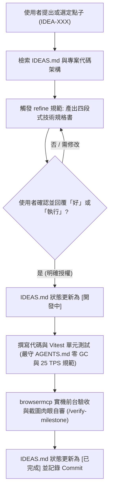

# IDEAS.md - 靈感與開發點子待辦池 (Ideas & Feature Backlog)

> **定位與用途**：本文件用於集中收納與維護開發者隨機記錄的玩法靈感、數值調校構想與新功能點子。  
> **Agent 核心守則**：**未獲使用者明確指令與授權前，任何 Agent 嚴禁擅自將此處的點子實作為代碼**。

---

## 1. Agent 調用與實作流程規範 (Workflow for Agents)

當使用者提及、指定某個 IDEA ID 或授權實作時，Agent 必須遵循以下標準化流程：



### 狀態定義 (Lifecycle Status)
- `[草稿 / 靈感]` (Idea)：僅記錄點子核心概念與初步構想，尚未深入細化。
- `[規格完備]` (Refined)：已完成四段式技術規格拆解（涉及檔案、常數數值、驗收標準）。
- `[待使用者授權]` (Pending Approval)：已就緒，等待使用者下達動工指令。
- `[開發中]` (In Progress)：使用者已授權，正在編程實作與測試。
- `[已完成]` (Completed)：已合併進主分支並通過實機驗收。
- `[已擱置]` (Shelved)：經評估暫不實作或被更佳方案取代。

---

## 2. 新增靈感範本 (Template for New Ideas)

```markdown
### [IDEA-XXX] 點子名稱
- **狀態**：`[草稿 / 靈感]`
- **分類**：`戰鬥與坦克職業` | `物理與地圖生態` | `AI 決策與戰術` | `視覺與音效表現` | `UI / UX` | `局外成長與 Roguelite`
- **核心玩法／概念說明**：
  - （簡述玩家體驗、核心機制或痛點解法）
- **涉及模組與架構考量**：
  - 涉及系統：`src/...`
  - 效能與紅線約束：是否涉及 25 TPS 熱路徑？是否需要物件池？
- **實作切入點與規格草案**：
  - 1. ...
  - 2. ...
- **驗收標準**：
  - [ ] ...
```

---

## 3. 待辦點子清單 (Feature & Idea Backlog)

### [IDEA-001] 中央五邊形巢穴 (The Nest) 與粉紅撞擊怪 (Crashers)
- **狀態**：`[草稿 / 靈感]`
- **分類**：`物理與地圖生態`
- **核心玩法／概念說明**：
  - 在地圖正中央 ($2000, 2000$) 劃定半徑約 400~600 範圍的深色蜂巢核心區。
  - 區域內高密度刷新大五邊形（Alpha Pentagon，血量極厚、提供海量 XP）與密集小五邊形。
  - 巢穴內生成專屬防衛實體：粉紅撞擊怪 (Crashers)，具備微型三角造型、高速度與仇恨追蹤機制，會群聚衝撞靠近的玩家或 AI 坦克。
- **涉及模組與架構考量**：
  - 涉及系統：[`src/systems/ShapeSystem.ts`](file:///c:/Users/weiqi/Projects/diep-rework/src/systems/ShapeSystem.ts), [`src/entities/Shape.ts`](file:///c:/Users/weiqi/Projects/diep-rework/src/entities/Shape.ts), [`src/rendering/GridRenderer.ts`](file:///c:/Users/weiqi/Projects/diep-rework/src/rendering/GridRenderer.ts), [`src/rendering/ShapeRenderer.ts`](file:///c:/Users/weiqi/Projects/diep-rework/src/rendering/ShapeRenderer.ts)。
  - 效能考量：Crasher 數量需做上限控管（池化管理），追蹤目標時利用 `SpatialHash` 尋找最近目標，避免每 tick 對全圖實體進行 $O(N)$ 距離計算。
- **實作切入點與規格草案**：
  - 擴充 `ShapeType` 加入 `AlphaPentagon` 與 `Crasher`。
  - `GridRenderer` 繪製地圖中央圓形巢穴陰影背景。
  - `ShapeSystem` 增加分區計數與 Crashers 加速度轉向衝撞邏輯。
- **驗收標準**：
  - [ ] 地圖中央正確呈現巢穴區域與 Alpha Pentagon。
  - [ ] Crasher 能鎖定入侵巢穴的玩家/AI 並加速衝撞，被擊毀時給予對應經驗。

---

### [IDEA-002] 排行榜第一名追蹤箭頭 (Leader Arrow)
- **狀態**：`[草稿 / 靈感]`
- **分類**：`UI / UX` / `戰鬥與坦克職業`
- **核心玩法／概念說明**：
  - 當玩家不是第一名時，螢幕視野邊緣（或玩家坦克外圍）始終顯示一個深灰/黑色箭頭，指向當前排行榜分數最高（Leader）的坦克位置。
  - 原汁原味還原原版 diep.io 獵殺第一名的動態張力，引導玩家與高等級 AI 發生交戰。
- **涉及模組與架構考量**：
  - 涉及系統：[`src/ui/HUD.ts`](file:///c:/Users/weiqi/Projects/diep-rework/src/ui/HUD.ts), [`src/core/Camera.ts`](file:///c:/Users/weiqi/Projects/diep-rework/src/core/Camera.ts), [`src/ui/Leaderboard.ts`](file:///c:/Users/weiqi/Projects/diep-rework/src/ui/Leaderboard.ts)。
  - 渲染層級：掛載於 `HUDContainer` 或 `WorldContainer` 的邊界投射計算。
- **實作切入點與規格草案**：
  - 每幀獲取 Leader 座標，若 Leader 位於相機視錐之外，計算視窗螢幕邊緣交點並渲染指示箭頭與名稱距離。
- **驗收標準**：
  - [ ] 非第一名時邊緣正確顯示指向 Leader 的動態箭頭。
  - [ ] 自己成為第一名時箭頭隱藏。

---

### [IDEA-003] 純前端 Web Audio API 向量音效生成器 (Procedural Audio)
- **狀態**：`[草稿 / 靈感]`
- **分類**：`視覺與音效表現`
- **核心玩法／概念說明**：
  - 不引入任何外部龐大音效音訊檔案（保持純前端輕量化與零依賴），使用原生 `AudioContext` 與 Oscillator / GainNode 合成音效：
    - 坦克開火聲（不同口徑對應頻率調製，如 Destroyer 低沉重砲、Machine Gun 連發脆響）。
    - 擊中形狀的鈍擊彈開聲。
    - 形狀或坦克爆裂粉碎的白噪音/粉紅噪音炸裂聲。
    - 升級與轉職時的激勵音效。
- **涉及模組與架構考量**：
  - 涉及系統：新建 `src/audio/SoundManager.ts`，由 `EventBus` 觸發事件解耦播放。
  - 瀏覽器策略：需在首次點擊或按鍵（用戶互動事件）後激活 `AudioContext`。
  - 效能考量：音效節點複用或短生命週期自動 GC，設定最大同時播放發聲數（Voice Limit）防破音。
- **驗收標準**：
  - [ ] 射擊、命中、爆炸均有對應合成音效，音量平衡且無爆音與卡頓。

---

### [IDEA-004] Tier 4 (Lv 45) 終極職業樹與分支擴充 (Tier 4 Expansion)
- **狀態**：`[草稿 / 靈感]`
- **分類**：`戰鬥與坦克職業`
- **核心玩法／概念說明**：
  - 將等級上限由 Lv 30 (6,184 分) 提升至原版滿級 Lv 45 (23,536 分)，累計 33 點技能點。
  - 擴充 Tier 4 經典職業分支：
    - Twin / Triple Shot 分支：Penta Shot, Spread Shot。
    - Sniper / Assassin 分支：Ranger, Stalker（隱身機制）。
    - Machine Gun / Destroyer 分支：Annihilator（巨型重砲與巨大後座力推進）。
    - Flank Guard / Twin Flank 分支：Octo Tank, Triple Twin。
- **涉及模組與架構考量**：
  - 涉及系統：[`src/config/tanks.config.ts`](file:///c:/Users/weiqi/Projects/diep-rework/src/config/tanks.config.ts), [`src/config/levels.config.ts`](file:///c:/Users/weiqi/Projects/diep-rework/src/config/levels.config.ts), [`src/rendering/TankRenderer.ts`](file:///c:/Users/weiqi/Projects/diep-rework/src/rendering/TankRenderer.ts)。
  - 規範相容：遵守 `tank-class-builder` skill 規範，嚴守 3.0px 邊框與砲管幾何標準。
- **驗收標準**：
  - [ ] Lv 45 升級查表與 33 點技能點解鎖。
  - [ ] 各分支能順暢於 Lv 45 彈出 Tier 4 轉職卡並正確渲染幾何。

---

### [IDEA-005] 無人機母艦系職業 (Overlord / Necromancer Drone System)
- **狀態**：`[草稿 / 靈感]`
- **分類**：`戰鬥與坦克職業` / `AI 決策與戰術`
- **核心玩法／概念說明**：
  - 實作經典的無人機（Drone）操控機制：
    - 不再從砲管直接發射常規子彈，而是從左右發射口定額生成小型三角形無人機護衛於身側。
    - 滑鼠左鍵引導無人機蜂擁撲向游標位置；右鍵（或 Shift 鍵）驅散/反向擴散無人機進行戰術包夾。
  - Necromancer：摧毀黃色方塊時將其「感化」為方形感染無人機，擁有龐大數量編隊。
- **涉及模組與架構考量**：
  - 涉及系統：新增 `src/entities/Drone.ts`, `src/systems/DroneSystem.ts`。
  - 效能考量：無人機群聚與迴避演算法（Boids / Flocking）需在 25 TPS 內維持極低 CPU 耗時，池化管理。
- **驗收標準**：
  - [ ] 無人機生成、集結護身、左鍵指引衝擊與右鍵擴散動作流暢無卡頓。

---

### [IDEA-006] 輕度局外 Roguelite 科技樹與晶片貨幣 (Meta-Progression)
- **狀態**：`[草稿 / 靈感]`
- **分類**：`局外成長與 Roguelite`
- **核心玩法／概念說明**：
  - 死亡結算時將該局累積得分依比例（例如 每 1000 分折算 1 枚「坦克核心晶片」）發放為局外持久貨幣。
  - 主選單或結算後可進入「科技研究室」加點永久天賦：
    - **開局特權**：出生初始等級提升（如開局 Lv 5 / Lv 10 / Lv 15）。
    - **採集提速**：擊毀幾何形狀獲得的經驗值小幅加成 (+5% ~ +20%)。
    - **自訂塗裝**：解鎖坦克本體色彩、特殊射擊尾跡。
- **涉及模組與架構考量**：
  - 儲存媒介：`localStorage` 本地安全序列化存檔，純前端無伺服器。
  - 核心防護：保留「純淨原版 Arcade 模式」切換開關，不影響想體驗原汁原味 diep 的玩家。
- **驗收標準**：
  - [ ] 死亡結算正確存儲晶片，科技加點後下一局開局正確套用加成。

---

### [IDEA-007] 實體化砲管碰撞箱 (Barrel Hitbox) 與獨立砲管耐久損壞機制 (Destructible Barrels)
- **狀態**：`[草稿 / 靈感]`
- **分類**：`戰鬥與坦克職業` | `物理與地圖生態`
- **核心玩法／概念說明**：
  - **砲管實體化碰撞 (Physical Barrels)**：
    - 將砲管從純視覺貼圖提升為物理實體的一部分。砲管具有寬度與長度的碰撞判定，子彈、形狀或敵方坦克觸碰砲管時會產生物理碰撞與阻擋。
    - **戰術深度**：長管坦克（如 Sniper、Assassin）的砲管可作為正面格擋護盾（例如用砲管硬接一發流彈保護核心），但同時受彈截面積大增；多砲管坦克（如 Flank Guard、Twin）側面或背後的砲管能無意中格擋偷襲。
  - **砲管獨立耐久度與破損停用 (Barrel HP & Degradation)**：
    - 每個砲管擁有獨立的生命值與損傷百分比（`barrelHp / barrelMaxHp`）。
    - 當砲管被子彈或形狀擊中時，承受傷害並優先扣除該砲管 HP（亦可依比例傳導微量震盪傷害至坦克本體）。
    - **破損狀態 (Broken)**：當砲管生命值歸零，該砲管判定為破損（視覺呈現燻黑、破裂或歪斜冒煙），並**立即失去發射子彈功能**（`FireSystem` 略過該砲管的裝填與射擊）。
    - **戰損與殘局體驗**：多砲管坦克（如 Twin, Triple Shot, Octo Tank）在交火中可能被打殘一側砲管，進入不對稱火力的破局殘戰；需制定修復機制（例如脫戰自然慢速回血、或特定升級點數維修）。
- **涉及模組與架構考量**：
  - **物理碰撞效能（零 GC 膠囊體演算法）**：
    - 涉及模組：[`src/physics/SpatialHash.ts`](file:///c:/Users/weiqi/Projects/diep-rework/src/physics/SpatialHash.ts), [`src/systems/CollisionSystem.ts`](file:///c:/Users/weiqi/Projects/diep-rework/src/systems/CollisionSystem.ts)。
    - **數學最優解 (Capsule-Circle)**：將砲管視為「膠囊體（線段 + 砲管半徑）」，圓形子彈與膠囊體的碰撞判定簡化為「子彈中心至砲管中心線段的最近距離平方 $\le (r_{\text{bullet}} + r_{\text{barrel}})^2$」。全程僅需向量點積與夾取，**無需平方根運算、零 GC 記憶體分配**，完美契合 25 TPS 與 600+ 高頻交火。
    - **廣相位半徑修正**：坦克的空間雜湊包圍半徑需擴展為 `tank.radius + maxBarrelLength`，確保不會漏檢。
  - **扁平資料模型 (Data Model)**：
    - 涉及實體：[`src/entities/Tank.ts`](file:///c:/Users/weiqi/Projects/diep-rework/src/entities/Tank.ts)。
    - 在 `Tank` 結構預配置固定長度 `Float32Array`（如 `barrelHp = new Float32Array(MAX_BARRELS)`），杜絕熱路徑物件分配。
  - **開火與冷卻系統**：
    - 涉及系統：[`src/systems/FireSystem.ts`](file:///c:/Users/weiqi/Projects/diep-rework/src/systems/FireSystem.ts)。
    - 開火邏輯中增加前置檢核：`if (tank.barrelHp[i] <= 0) continue;`，破損砲管跳過後座力衝量與子彈生成。
  - **視覺與渲染表現**：
    - 涉及模組：[`src/rendering/TankRenderer.ts`](file:///c:/Users/weiqi/Projects/diep-rework/src/rendering/TankRenderer.ts)。
    - 依據 `barrelHp` 比例動態混合灰色/焦黑碳化顏色，完全損毀時可掛載少量池化冒煙粒子。
- **實作切入點與規格草案**：
  - 1. 於 `tanks.config.ts` 定義各砲管基礎耐久係數（或與砲管尺寸成正比：`barrelMaxHp = baseBodyHp * 0.3 * (length * width) / scale`）。
  - 2. 於 `CollisionSystem` 新增 `testCircleCapsule` 輔助無 GC 數學函式，處理子彈/形狀撞擊砲管的衝量與扣血。
  - 3. 於 `RegenSystem` 擴充脫戰一定時間後的砲管修復邏輯（或 Hyper-Regen 連動修復）。
  - 4. 於 `TankRenderer` 增設砲管耐久視覺回饋（破損燻黑效果）。
- **驗收標準**：
  - [ ] 子彈射向砲管延伸區時能準確被砲管阻擋，不穿透至坦克本體。
  - [ ] 砲管受到足夠傷害後 HP 歸零，並停止該砲管後續子彈發射。
  - [ ] 多砲管坦克（如 Twin）單管破損後，另一根正常砲管仍能持續射擊。
  - [ ] 高頻物理碰撞在 600+ 子彈下維持 25 TPS 穩定與零記憶體垃圾產生。

---

### [IDEA-008] 高速子彈動態模糊與速度拖尾特效 (Bullet Motion Blur & Velocity Streak)
- **狀態**：`[草稿 / 靈感]`
- **分類**：`視覺與音效表現`
- **核心玩法／概念說明**：
  - **視覺沉浸與動態衝擊感**：
    - 為飛行中的子彈注入動態模糊（Motion Blur）或流線型速度拖影（Streak / Trail），大幅強化高速交火與重砲出膛時的震撼感。
    - 尤其能顯著突顯不同口徑與速度特質：如 Sniper / Assassin 的極速穿甲長軌跡、Destroyer 巨砲出膛時的重型氣浪拖影、Machine Gun 漫天飛舞的短促光梭。
  - **動態強度連動速度**：
    - 模糊或拉伸長度與子彈實時速度成正比；子彈在射程末段減速或即將消失時，模糊自然收縮消退還原為常規圓形。
- **涉及模組與架構考量**：
  - **效能紅線警告（絕對禁止 Pixi.js 內建 `BlurFilter`）**：
    - 若對物件池中 600+ 顆子彈逐一掛載 `BlurFilter`，會觸發每幀數百次 Framebuffer Object (FBO) 離屏紋理切換，徹底打碎 WebGL 批次繪製（Batch Rendering），將 120+ FPS 暴跌至個位數。
  - **三大高效零 GC 實作技術路線評估**：
    - **路線 1：速度方向幾何動態伸展 (Velocity-Aligned Squash & Stretch - 推薦首選)**
      - 依據子彈當前向量 $(vx, vy)$ 計算角度 `sprite.rotation = Math.atan2(vy, vx)`。
      - 依速度大小將 X 軸（長度）依比例拉伸 `scale.x = baseScale * (1.0 + speed * STRETCH_FACTOR)`，保持 Y 軸（直徑）不變。
      - 優勢：**零額外 Draw Call、零新增 Sprite、100% 保持 GPU Batching、零 GC**。
    - **路線 2：預烘培彗星/水滴型高解析度超取樣貼圖 (Pre-baked Motion Blur Texture)**
      - 預先烘培帶有尾部柔和漸隱（Alpha Gradient）的高解析度水滴/流線貼圖，並嚴格維持 3.0px 恆定描邊（紅線 2）。
      - 速度高於門檻時動態切換貼圖或以雙層疊加呈現。
    - **路線 3：極簡批次網格拖尾帶 (Batch Mesh / Quad Ribbon)**
      - 在子彈 `prevX, prevY` 與當前插值 `rx, ry` 之間繪製半透明梯形連線，生命週期僅 1~2 幀。
  - **設定與除錯支援**：
    - 在 [`src/debug/DebugOverlay.ts`](file:///c:/Users/weiqi/Projects/diep-rework/src/debug/DebugOverlay.ts) 中增設「動態模糊開關（Motion Blur）」與「拉伸強度滑桿」，方便隨時比較視覺差異與監控 120 FPS 幀率。
- **實作切入點與規格草案**：
  - 1. 於 `src/config/constants.ts` 宣告 `BULLET_MOTION_BLUR_ENABLED = true` 與 `BULLET_STRETCH_FACTOR`（可調常數）。
  - 2. 於 [`src/rendering/BulletRenderer.ts`](file:///c:/Users/weiqi/Projects/diep-rework/src/rendering/BulletRenderer.ts) 的 `update` 迴圈中，利用 `bullet.vx` 與 `bullet.vy` 計算旋轉角並動態賦予 `sprite.rotation` 與非等比縮放 `scale.set(scaleX, scaleY)`。
  - 3. 確保子彈漸逝 `fadeProgress` 與動態模糊長度平滑融合。
- **驗收標準**：
  - [ ] 子彈移動時順著飛行方向呈現自然的速度拉伸與動態流線感，靜止或慢速時還原為標準正圓。
  - [ ] 600 子彈高密度交火壓力測試下，FPS 穩定維持在 120+ FPS，Draw Call 不暴增。
  - [ ] 邊框視覺厚度不因非等比縮放產生嚴重形變或模糊，符合視覺標準。


