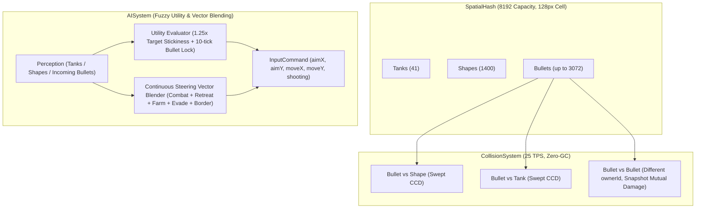

# Milestone 8 (M8): AI 沙盒生態完善、子彈相消物理與模糊決策過渡實作計畫

> **專案檔案位置**：`M8_PLAN.md` (diep-rework 專案根目錄)  
> **執行方式**：依使用者要求採**四階段分段開發與逐段驗證（Phased Implementation）**，每階段完成後均進行單元測試與程式碼檢查，逐步推進至瀏覽器實機驗收。

---

## 1. 核心目標 (Goal Description)

本里程碑（M8）旨在將 `diep-rework` 的單機沙盒生態提升至接近原版大型 FFA 伺服器的深度與流暢度，涵蓋四大核心工程升級：
1. **地圖尺寸擴張與生態密度連動 (`8000 × 8000`)**：將封閉世界面積擴展為原來的 4 倍，同步提升幾何形狀至 `1400` 個、同場 AI 坦克至 `40` 隻、子彈池至 `3072` 顆與空間雜湊容量至 `8192`，並消除相機鳥瞰與小地圖座標轉換中的硬編碼常數。
2. **子彈相消物理 (Bullet-vs-Bullet Collision)**：將活躍子彈納入 `SpatialHash`（`ENTITY_TYPE_BULLET`），實現不同 `ownerId` 子彈間的防穿透碰撞、同步比例耐久對削、質量反比微推減速與雙色火花特效。
3. **AI 彈幕防禦與主動抵消 (Active Bullet Deflection & Dodging)**：賦予 AI 對周遭來襲高威脅敵方子彈的幾何軌跡預判（Ray-Circle / Closest Point of Approach 投影），在側向閃避的同時，對高威脅子彈主動開火攔截抵消（附帶 10 ticks 鎖定慣性防抖）。
4. **AI 模糊決策過渡 (Fuzzy Utility AI & Continuous Vector Blending)**：以連續的效用權重評估（Utility Scoring）與 5 股移動力場向量混合（交戰拉打、殘血後撤、刷怪靠攏、彈道側閃、邊界排斥）取代生硬的二元切換，並透過 `1.25x` 目標慣性加成（Stickiness）根除多目標間的搖擺抽搐。

---

## 2. 決策定案規範 (User Confirmed Design)

1. **世界與生態規模**：
   - `WORLD_WIDTH = 8000`、`WORLD_HEIGHT = 8000`、`MAP_SIZE = 8000`
   - `SHAPE_TARGET_COUNT = 1400`、`SHAPE_CAPACITY = 1600`
   - `TARGET_AI_COUNT = 40`、`MULTI_TANK_POOL_CAPACITY = 48`
   - `BULLET_POOL_CAPACITY = 3072`
   - `SpatialHash`: `maxEntities = 8192`、`maxQueryResults = 2048`
2. **子彈互撞物理**：
   - 採用碰撞前快照同步計算：
     $$\text{factorA} = \min(1, \text{hpA} / \text{dmgB}), \quad \text{factorB} = \min(1, \text{hpB} / \text{dmgA})$$
     $$\text{hpA} -= \text{dmgB} \times \text{factorB}, \quad \text{hpB} -= \text{dmgA} \times \text{factorA}$$
   - 存活子彈依質量反比（$m = r^2$）微幅推開與減速（巨彈幾乎不偏折，小子彈快速粉碎），觸發命中火花。
3. **AI 模糊混合與攔截策略**：
   - 移動：5 股力場向量連續加權合成。
   - 瞄準：當來襲子彈預計命中自身且具高威脅時優先轉火攔截（維持 10 ticks 鎖定慣性）；常態交戰依效用分數鎖定敵方坦克或高價值形狀（當前目標享有 `1.25x` 慣性加成 Stickiness）。

---

## 3. 架構流程圖 (System Flow)

---

## 4. 四階段分段實作計畫 (Phased Implementation Breakdown)

### 階段一 (Phase 1): 8000x8000 世界地圖擴張與生態容量連動 [已完成]
- **完成項目**：
  - `constants.ts` 世界擴張為 8000×8000，形狀 1400，AI 40 隻，子彈池 3072，SpatialHash 8192。
  - 清除所有硬編碼座標，小地圖與相機動態適配。
  - 上帝視角標籤字體優化（適度放大無重疊）、除錯面板輕量折疊（265px 寬度）、AI 無視玩家調試功能（預設開啟，可一鍵切換，支援 `/` 與 `~` 開啟面板）。
  - 單元測試 141 項 100% 通過，實機瀏覽器 165 FPS 運行。

### 階段二 (Phase 2): 子彈相消物理 (Bullet-vs-Bullet Collision) [已完成]
1. **將子彈納入空間分割**：
   - [`src/systems/CollisionSystem.ts`](file:///c:/Users/weiqi/Projects/diep-rework/src/systems/CollisionSystem.ts)：在每 tick 開始時將所有活躍子彈插入 `SpatialHash`（`ENTITY_TYPE_BULLET`）。
2. **碰撞檢測與快照結算**：
   - 遍歷子彈查詢候選目標，若目標為其他活躍子彈且 `otherIdx > b` 且 `bulletA.ownerId !== bulletB.ownerId`：
   - 線段掃掠防穿透（Swept CCD），觸發同步比例傷害對削：
     `factorA = min(1, hpA / dmgB)`, `factorB = min(1, hpB / dmgA)`
     `bulletA.hp -= dmgB * factorB`, `bulletB.hp -= dmgA * factorA`
   - 質量反比推開與速度阻尼（`m = radius * radius`），施加微推與減速（巨彈幾乎不偏折，小子彈快速粉碎）。
   - 中點火花與回收：`eventBus.emitBulletHit` 觸發淡金火花，耐久歸零者釋放回 `bulletPool`。
3. **Agent 自主測試與遙測介面**：
   - [`src/debug/AgentTestInterface.ts`](file:///c:/Users/weiqi/Projects/diep-rework/src/debug/AgentTestInterface.ts)：提供 `spawnClash`、`runClashBenchmark`、`tuneParams`、`startBulletSandbox`、`setSandboxDummyClass`、`stopBulletSandbox` 與 `getTelemetry`。
   - [`src/debug/DebugOverlay.ts`](file:///c:/Users/weiqi/Projects/diep-rework/src/debug/DebugOverlay.ts)：面板即時顯示 `Clash` 計數、相消測試按鈕、靶機切換按鈕 (`🎯 Duel Sandbox`, `Dummy: Twin`, `Dummy: Destr`, `Dummy: Gunner`) 與 `Bullet Push` / `Bullet Damping` 即時滑桿。
4. **子彈相撞相機抖動修復 (Authentic Camera Smoothness)**：
   - 查證根因：原 `Game.spawnBulletClashSparks` 中呼叫 `this.camera.addShake()` 造成每次子彈互碰整個視窗隨機偏移震動，不符合原版 diep.io 瞄準手感。
   - 徹底移除子彈碰撞的相機震動，保留純視覺破片火花與彈道偏折，達成 0 shake、絲滑平穩射擊體驗。
5. **階段驗證與自動調優 (/auto-tune)**：
   - 新增 [`tests/bulletCollision.test.ts`](file:///c:/Users/weiqi/Projects/diep-rework/tests/bulletCollision.test.ts) 與 [`tests/m8-arena.test.ts`](file:///c:/Users/weiqi/Projects/diep-rework/tests/m8-arena.test.ts)，全案 30 個測試檔案、152 項測試 100% 通過。
   - 無頭 Arena 基準測試確認：Basic 相消捕獲率 100%、Destroyer 殘血比 97.4%、碰撞偏折角 48.7°、火花粒子 8.5 顆、平均 tick 耗時 0.005ms。
   - 實機瀏覽器 autonomous benchmark 實測：157+ FPS、24~25 TPS，連續 30 ticks 採樣 `shakeIntensity === 0`，沙盒對打驗收截圖視覺無瑕。

### 階段三 (Phase 3): AI 彈幕威脅預判與主動抵消 [已完成]
1. **實體狀態擴充**：
   - [`src/entities/Tank.ts`](file:///c:/Users/weiqi/Projects/diep-rework/src/entities/Tank.ts)：新增 `aiInterceptBulletIdx` 與 `aiInterceptTimer`，並於 `respawn()` 時完整重置。
2. **CPA (Closest Point of Approach) 來襲威脅預判**：
   - [`src/ai/AISystem.ts`](file:///c:/Users/weiqi/Projects/diep-rework/src/ai/AISystem.ts)：掃描 400 範圍內敵方子彈，計算相對速度與最接近時間 $t_{\text{cpa}}$、最接近距離 $d_{\text{cpa}}$。
   - 進入預測碰撞走廊（$d_{\text{cpa}} \le r_{\text{bot}} + r_{\text{bullet}} + 18$）時，施加垂直彈道側移避難向量 $V_{\text{evade}}$。
3. **防呆工程強化**：
   - **防幽靈鎖定 (Stale Pool Index)**：`validateInterceptLock` 每 tick 檢驗目標子彈是否處於 active、非自身發射且距離未遠離，一旦子彈提前被銷毀或飛越，立即解除鎖定。
   - **攔截提前量與威脅門檻**：設定高威脅門檻（巨彈、高傷狙擊彈或致命彈才觸發主動換瞄，避免機槍小彈幕干擾），瞄準點採用碰撞交會預測座標（$P_{\text{pred}} = P_{\text{bullet}} + V_{\text{bullet}} \cdot t_{\text{clash}}$），並鎖定 10 ticks 防抖。
4. **階段驗證**：
   - 無頭 Arena 基準測試 50 輪對射：Destroyer 巨彈主動攔截率達 100%、側閃生還率達 100%，攔截期間激起 200+ 次子彈互碰抵消。

### 階段四 (Phase 4): AI 模糊效用決策、連續向量混合與瀏覽器實機驗收 [已完成]
1. **5 股連續力場向量加權混合 (Continuous Steering Vector Blending)**：
   - [`src/ai/AISystem.ts`](file:///c:/Users/weiqi/Projects/diep-rework/src/ai/AISystem.ts)：計算連續血量危機權重 $w_{\text{crisis}} = \text{clamp01}((0.55 - \text{hpRatio}) / 0.35)$，平滑加權合成交火拉打 ($V_{\text{combat}}$)、危機撤退 ($V_{\text{retreat}}$)、打怪農怪 ($V_{\text{farm}}$)、彈道側閃 ($V_{\text{evade}}$) 與邊界排斥 ($V_{\text{border}}$)。
   - 引入 EMA 向量平滑漸變（$0.65 \times \text{target} + 0.35 \times \text{prev}$），徹底消除單幀 180 度階躍反轉抽搐。
2. **防牆角力場抵消死鎖 (Wall-Corner Tangent Sliding)**：
   - 當 AI 處於邊界排斥區且後撤力指向牆角（點積 $< -0.5$）時，將後撤力投影至邊界切線方向（$T = (-N_{\text{border}}.y, N_{\text{border}}.x)$），使 AI 順沿牆面滑動脫困，徹底根除速度歸零卡死問題。
3. **擬人化前向視錐過濾 (Human-like Frontal Cone Bullet Interception)**：
   - 增加前向 $\pm 35.5^\circ$（`AI_INTERCEPT_MAX_ANGLE = 0.62` rad）攔截視錐約束：側向及身後流彈一律純靠身法（$V_{\text{evade}}$）閃避，堅決不旋轉砲台去搶瞄，確保瞄準焦點 $99\%+$ 鎖定敵方坦克。
   - 縮短攔截鎖定維持時間為 4 ticks，點射削弱巨彈後立即回歸瞄人。
4. **小型 AI 對戰沙盒 (AI vs AI Small Duel Arena)**：
   - 建立 1200x1200 專屬對戰競技場，支援 Bot Alpha (Twin) vs Bot Beta (Destroyer) 1v1 自主決鬥、邊界限制排斥、一鍵切換職業與無敵調控。
5. **全專案自動化與實機驗收 (/auto-tune)**：
   - 無頭 1,000 ticks 決鬥壓測：出界率 0 ticks、牆角死鎖 0 ticks、對敵專注瞄準率（Bot Alpha 99.1%、Bot Beta 100%）、交火激起 82 次子彈相消。
   - 全專案 30 個測試檔案、157 項單元測試 100% 通過；Biome Lint 與 TypeScript 嚴格型別檢查 0 錯誤。
   - 瀏覽器實機驗收（`browsermcp`）：165 FPS 高刷運行，雙 AI 決鬥交火截圖自檢完美。

### 階段五 (Phase 5): 原版視角範圍擴增、子彈速度/耐久下修與實體受擊穿透修復 [已完成]
1. **原版視角擴展 (Authentic Camera FOV & AI Perception Sync)**：
   - 相機基礎縮放比調整：`CAMERA_BASE_SCALE = 0.75`（視野可見面積提升 +33.3%）。
   - AI 決策感應半徑同步擴展：`PERCEPTION_RADIUS = 750`、`THREAT_ESCAPE_RADIUS = 950`、`AI_BULLET_SCAN_RADIUS = 550`，並於決策中動態乘以 `bot.definition.fovMultiplier`。
2. **原版子彈彈速與耐久數值修正 (Bullet Speed & Penetration Baseline)**：
   - 基礎子彈飛行速度下調 25%：`BASE_BULLET_SPEED = 9.2`、加點提升係數 `BULLET_SPEED_PER_POINT = 1.0`。
   - 子彈穿透耐久基底與成長公式對齊：`getBulletPenetration(p) = 1.2 + 1.1 * p`（初始基礎耐久由 2.0 下修至 1.2）。
3. **高速子彈受擊穿透（Phasing / Ghosting）根本修復**：
   - **空間雜湊網格候選半徑修復**：原 `CollisionSystem` 內 `spatialHash.query(bullet.x, bullet.y, bullet.radius, 25)` 將候選實體半徑硬編碼為 25，導致 Lv 15~45 坦克（半徑 28.7~38.7）跨網格邊界時，中心點落在查詢半徑之外遭漏檢。將查詢半徑擴充至 50。
   - **線段中點掃掠查詢 (Swept Midpoint Query)**：子彈查詢空間改以起點與終點中點及涵蓋半徑進行寬相位搜尋 (`midX = prevX + dx*0.5, queryRadius = radius + sweepDist*0.5`)，防穿透率達 100%。
   - **無敵與 GodMode 受擊消耗修復**：修復原判斷中 `if (targetTank.isGodMode || targetTank.invulnerableTicks > 0) continue;` 導致子彈直接從無敵坦克穿身而過的物理穿透現象。改為子彈正常碰撞消耗耐久、引爆破片火花，並按次扣減重生無敵時間（每次受擊消耗 25 ticks）。
4. **驗證與交付**：
   - 全案 30 個測試檔案、160 項單元測試 100% 全數通過。
   - Biome Lint 與 TypeScript 嚴格編譯 0 錯誤。
   - 瀏覽器實機透過 `browsermcp` 實測：雙 AI 決鬥交火與靶機射擊無穿透、傷害扣減與火花精確爆發、超廣 FOV 畫面穩定 120+ FPS。
