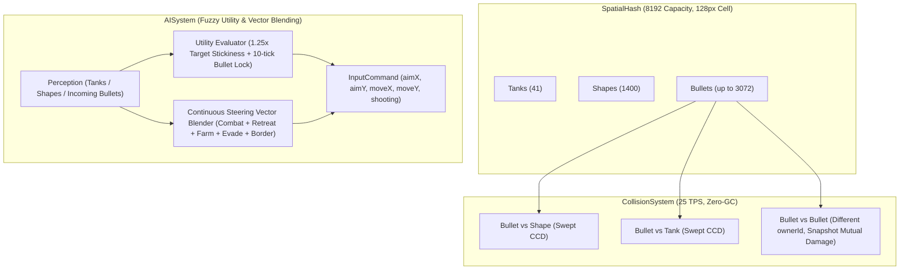

# Milestone 8 (M8): AI 沙盒生態完善、子彈相消物理與模糊決策過渡實作計畫

> **專案檔案位置**：`M8_PLAN.md` (diep-rework 專案根目錄)  
> **執行方式**：依使用者要求採**四階段分段開發與逐段驗證（Phased Implementation）**，每階段完成後均進行單元測試與程式碼檢查，逐步推進至瀏覽器實機驗收。

---

## 1. 核心目標 (Goal Description)

本里程碑（M8）旨在將 `diep-rework` 的單機沙盒生態提升至接近原版大型 FFA 伺服器的深度與流暢度，涵蓋四大核心工程升級：
1. **地圖尺寸擴張與生態密度連動 (`8000 × 8000`)**：將封閉世界面積擴展為原來的 4 倍，同步提升幾何形狀至 `1400` 個、同場 AI 坦克至 `40` 隻、子彈池至 `3072` 顆與空間雜湊容量至 `8192`，並消除相機鳥瞰與小地圖座標轉換中的硬編碼常數。
2. **子彈相消物理 (Bullet-vs-Bullet Collision)**：將活躍子彈納入 `SpatialHash`（`ENTITY_TYPE_BULLET`），實現不同 `ownerId` 子彈間的防穿透碰撞、同步比例耐久對削、質量反比微推減速與雙色火花特效。
3. **AI 彈幕防禦與主動抵消 (Active Bullet Deflection & Dodging)**：賦予 AI 對周遭來襲高威脅敵方子彈的幾何軌跡預判（Ray-Circle / Closest Point of Approach 投影），在側向閃避的同時，對高威脅子彈主動開火攔截抵消（附帶 10 ticks 鎖定慣性防抖）。
4. **AI 模糊決策過渡 (Fuzzy Utility AI & Continuous Vector Blending)**：以連續的效用權重評估（Utility Scoring）與 5 股移動力場向量混合（交戰拉打、殘血後撤、刷怪靠攏、彈道側閃、邊界排斥）取代生硬的二元切換，並透過 `1.25x` 目標慣性加成（Stickiness）根除多目標間的搖擺抽搐。

---

## 2. 決策定案規範 (User Confirmed Design)

1. **世界與生態規模**：
   - `WORLD_WIDTH = 8000`、`WORLD_HEIGHT = 8000`、`MAP_SIZE = 8000`
   - `SHAPE_TARGET_COUNT = 1400`、`SHAPE_CAPACITY = 1600`
   - `TARGET_AI_COUNT = 40`、`MULTI_TANK_POOL_CAPACITY = 48`
   - `BULLET_POOL_CAPACITY = 3072`
   - `SpatialHash`: `maxEntities = 8192`、`maxQueryResults = 2048`
2. **子彈互撞物理**：
   - 採用碰撞前快照同步計算：
     $$\text{factorA} = \min(1, \text{hpA} / \text{dmgB}), \quad \text{factorB} = \min(1, \text{hpB} / \text{dmgA})$$
     $$\text{hpA} -= \text{dmgB} \times \text{factorB}, \quad \text{hpB} -= \text{dmgA} \times \text{factorA}$$
   - 存活子彈依質量反比（$m = r^2$）微幅推開與減速（巨彈幾乎不偏折，小子彈快速粉碎），觸發命中火花。
3. **AI 模糊混合與攔截策略**：
   - 移動：5 股力場向量連續加權合成。
   - 瞄準：當來襲子彈預計命中自身且具高威脅時優先轉火攔截（維持 10 ticks 鎖定慣性）；常態交戰依效用分數鎖定敵方坦克或高價值形狀（當前目標享有 `1.25x` 慣性加成 Stickiness）。

---

## 3. 架構流程圖 (System Flow)

---

## 4. 四階段分段實作計畫 (Phased Implementation Breakdown)

### 階段一 (Phase 1): 8000x8000 世界地圖擴張與生態容量連動 [已完成]
- **完成項目**：
  - `constants.ts` 世界擴張為 8000×8000，形狀 1400，AI 40 隻，子彈池 3072，SpatialHash 8192。
  - 清除所有硬編碼座標，小地圖與相機動態適配。
  - 上帝視角標籤字體優化（適度放大無重疊）、除錯面板輕量折疊（265px 寬度）、AI 無視玩家調試功能（預設開啟，可一鍵切換，支援 `/` 與 `~` 開啟面板）。
  - 單元測試 141 項 100% 通過，實機瀏覽器 165 FPS 運行。

### 階段二 (Phase 2): 子彈相消物理 (Bullet-vs-Bullet Collision) [已完成]
1. **將子彈納入空間分割**：
   - [`src/systems/CollisionSystem.ts`](file:///c:/Users/weiqi/Projects/diep-rework/src/systems/CollisionSystem.ts)：在每 tick 開始時將所有活躍子彈插入 `SpatialHash`（`ENTITY_TYPE_BULLET`）。
2. **碰撞檢測與快照結算**：
   - 遍歷子彈查詢候選目標，若目標為其他活躍子彈且 `otherIdx > b` 且 `bulletA.ownerId !== bulletB.ownerId`：
   - 線段掃掠防穿透（Swept CCD），觸發同步比例傷害對削：
     `factorA = min(1, hpA / dmgB)`, `factorB = min(1, hpB / dmgA)`
     `bulletA.hp -= dmgB * factorB`, `bulletB.hp -= dmgA * factorA`
   - 質量反比推開與速度阻尼（`m = radius * radius`），施加微推與減速（巨彈幾乎不偏折，小子彈快速粉碎）。
   - 中點火花與回收：`eventBus.emitBulletHit` 觸發淡金火花，耐久歸零者釋放回 `bulletPool`。
3. **Agent 自主測試與遙測介面**：
   - [`src/debug/AgentTestInterface.ts`](file:///c:/Users/weiqi/Projects/diep-rework/src/debug/AgentTestInterface.ts)：提供 `spawnClash`、`runClashBenchmark`、`tuneParams`、`startBulletSandbox`、`setSandboxDummyClass`、`stopBulletSandbox` 與 `getTelemetry`。
   - [`src/debug/DebugOverlay.ts`](file:///c:/Users/weiqi/Projects/diep-rework/src/debug/DebugOverlay.ts)：面板即時顯示 `Clash` 計數、相消測試按鈕、靶機切換按鈕 (`🎯 Duel Sandbox`, `Dummy: Twin`, `Dummy: Destr`, `Dummy: Gunner`) 與 `Bullet Push` / `Bullet Damping` 即時滑桿。
4. **子彈相撞相機抖動修復 (Authentic Camera Smoothness)**：
   - 查證根因：原 `Game.spawnBulletClashSparks` 中呼叫 `this.camera.addShake()` 造成每次子彈互碰整個視窗隨機偏移震動，不符合原版 diep.io 瞄準手感。
   - 徹底移除子彈碰撞的相機震動，保留純視覺破片火花與彈道偏折，達成 0 shake、絲滑平穩射擊體驗。
5. **階段驗證與自動調優 (/auto-tune)**：
   - 新增 [`tests/bulletCollision.test.ts`](file:///c:/Users/weiqi/Projects/diep-rework/tests/bulletCollision.test.ts) 與 [`tests/m8-arena.test.ts`](file:///c:/Users/weiqi/Projects/diep-rework/tests/m8-arena.test.ts)，全案 30 個測試檔案、152 項測試 100% 通過。
   - 無頭 Arena 基準測試確認：Basic 相消捕獲率 100%、Destroyer 殘血比 97.4%、碰撞偏折角 48.7°、火花粒子 8.5 顆、平均 tick 耗時 0.005ms。
   - 實機瀏覽器 autonomous benchmark 實測：157+ FPS、24~25 TPS，連續 30 ticks 採樣 `shakeIntensity === 0`，沙盒對打驗收截圖視覺無瑕。

### 階段三 (Phase 3): AI 彈幕威脅預判與主動抵消
1. **實體狀態擴充**：
   - [`src/entities/Tank.ts`](file:///c:/Users/weiqi/Projects/diep-rework/src/entities/Tank.ts)：新增 `aiInterceptBulletIdx` 與 `aiInterceptTimer`。
2. **CPA (Closest Point of Approach) 來襲威脅預判**：
   - [`src/ai/AISystem.ts`](file:///c:/Users/weiqi/Projects/diep-rework/src/ai/AISystem.ts)：掃描 380 範圍內敵方子彈，計算相對速度與最接近時間 $t_{\text{cpa}}$、最接近距離 $d_{\text{cpa}}$。
   - 判定即將命中時：垂直彈道側移閃避（Strafe），且高威脅子彈觸發主動瞄準攔截（鎖定 10 ticks 防抖）。
3. **階段驗證**：
   - 新增單元測試驗證 AI 在來襲彈幕下產生垂直閃避與開火攔截朝向。

### 階段四 (Phase 4): AI 模糊效用決策、連續向量混合與瀏覽器實機驗收
1. **連續力場向量混合 (Continuous Steering Vector Blending)**：
   - [`src/ai/AISystem.ts`](file:///c:/Users/weiqi/Projects/diep-rework/src/ai/AISystem.ts)：計算連續血量危機權重 $w_{\text{retreat}}$，連續加權混合交火風箏、殘血後撤、刷怪靠攏、彈道側閃與邊界排斥 5 股向量。
2. **具慣性的效用瞄準 (Utility Aiming with Stickiness)**：
   - 引入 `1.25x` 當前目標慣性加成，消除多目標搖擺抽搐。
3. **全專案自動化與實機驗收**：
   - 完整運行全數 Vitest 單元測試與 Biome lint。
   - 透過 `browsermcp` 實機切換神經視角、對射子彈互消、檢查 40 AI 與 1400 形狀大生態運行、截圖審查。
   - 撰寫 Walkthrough 與提交 Git Commit。
