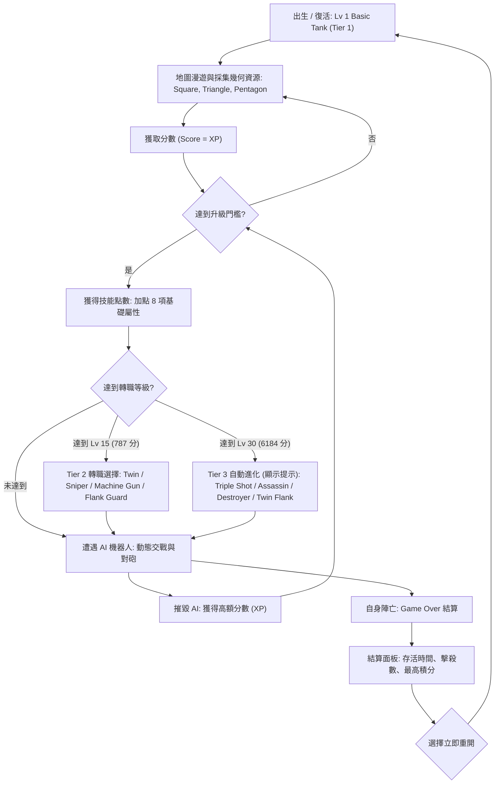
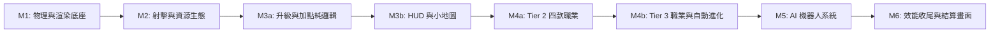

# diep.io Rework (網頁版俯視角坦克射擊遊戲) 企劃與技術規劃

---

## 1. 專案願景與定位

本專案旨在以現代前端技術重構經典網頁遊戲 **[diep.io](https://diep.io/)** 的核心玩法：
俯視角 2D 射擊、多邊形資源採集升級、8 項屬性加點強化、多砲管坦克進化轉職。
- **定位**：純前端、桌面瀏覽器即開即玩的單機版（玩家 vs AI 機器人）。
- **操作方式**：鍵盤 WASD 移動、滑鼠瞄準與點擊/按住連續射擊、快捷鍵 1~8 屬性升級、`E` 鍵自動射擊（輸入統一採用 `KeyboardEvent.code`）。
- **未來擴展性**：MVP 階段專注極致街機手感與原版數值還原，架構預留「輕度 Roguelite 局外科技樹」與「多人網路連線（WebSocket/WebRTC）」介面。

---

## 2. 核心玩法循環 (Core Gameplay Loop)



### 單局與長期生態演進
1. **MVP 階段（純 Arcade 模式）**：
   - 單局獨立、即死即結算，死亡後重置為 Tier 1 Basic Tank，專注於精確還原原版數值、打怪與走位對砲手感。
   - **Tier 3 (Lv 30) 自動進化**：Lv 30 的職業選擇在 MVP 暫時禁用（透過常數旗標 `ENABLE_TIER3_CHOICE = false` 控制）；當玩家達到 Lv 30 時，依其 Lv 15 (Tier 2) 職業自動進化為唯一對應的 Tier 3 職業，不彈出選擇視窗，僅於畫面顯示進化提示。程式架構保留通用判斷：當候選職業數量 `> 1` 時才顯示 `EvolutionPanel`。
   - **AI 行為**：採用**動態等級生成（Scaled Spawning）**。地圖常駐 15~30 隻 AI，系統根據玩家目前等級動態生成實力相仿的坦克與職業，簡化前期邏輯。
2. **後續階段（Phase 2: 職業樹擴充、Roguelite & 生態升級）**：
   - **開放 Lv 30 (Tier 3) 自由選擇與擴充坦克樹**，並延伸至 Lv 45 (Tier 4) 終極職業。
   - 死亡結算獲得晶片貨幣，解鎖主選單永久天賦（開局初始等級、經驗加成等）。
   - AI 升級為**模擬玩家生態（Simulated Players）**，具備同等打怪升級、加點策略與互咬生態。

---

## 3. 範疇矩陣 (MVP vs. Phase 2)

| 功能模組 | MVP 階段範疇 | 後續階段 (Phase 2 & 3) |
| :--- | :--- | :--- |
| **坦克職業樹** | **9 款坦克**：<br>• **Tier 1 (Lv 1)**: Basic Tank<br>• **Tier 2 (Lv 15 自由四選一)**: Twin, Sniper, Machine Gun, Flank Guard<br>• **Tier 3 (Lv 30 自動唯一進化，選擇功能禁用)**: Triple Shot, Assassin, Destroyer, Twin Flank | • **開放 Lv 30 (Tier 3) 多分支選擇與擴充坦克樹**<br>• **Tier 4 (Lv 45)** 終極職業（Penta Shot, Ranger, Annihilator 等）<br>• 複雜機制（Overlord 無人機系、Trapper 陷阱系、Necromancer） |
| **等級上限** | **Lv 30 滿級**（6,184 分），累計獲得 **28 點技能點** | 擴展至 **Lv 45 滿級**（23,536 分），累計 **33 點技能點** |
| **幾何資源** | 黃色方塊 (Square)、紅色三角 (Triangle)、藍色五邊形 (Pentagon) | 中央五邊形巢穴 (The Nest)、Alpha Pentagon、粉紅撞擊怪 Crashers |
| **地圖機制** | 固定 4000x4000 封閉網格邊界、右上角簡易小地圖（顯示玩家自身標記） | 巢穴區域警示、排行榜第一名箭頭追蹤指示 (Leader Arrow)、隊伍系統 |
| **AI 機器人** | 動態等級生成（Scaled Spawner），依玩家等級刷出對應坦克，經由 `InputCommand` 控制走位與射擊 | 模擬玩家生態（自主發育、自動加點、互相戰鬥）、高階戰術逃跑與繞後 |
| **局外系統** | 純單局結算，無局外存檔 | 輕度 Roguelite 科技樹（天賦加點、自訂塗裝、開局特權） |
| **音效與特效** | 基礎射擊特效、物體碎裂粒子反衝動畫 | 向量音效（Web Audio API 生成器）、低音砲擊震撼、擊殺提示廣播 |

---

## 4. 技術選型 (Tech Stack)

- **核心語言**：`TypeScript (v5.x)`（全專案開啟 `strict: true`，禁止 `any`）
- **程式碼規範與檢查**：`@biomejs/biome`（單一高效工具包辦格式化與檢查，強制啟用 `noExplicitAny: error`，執行 `npm run lint` = `biome check`）
- **建置工具**：`Vite (v6.x)`（極速 HMR 開發環境與零負擔打包）
- **渲染引擎**：`Pixi.js (v8.x)`（硬體 WebGL / WebGPU 批次渲染）
  - **Pixi v8 強制規範**：
    1. 應用程式初始化必須使用非同步 `await app.init({ ... })`。
    2. `Graphics` 採用 v8 新版 API：先繪製幾何（如 `circle()`, `rect()`, `poly()`）再呼叫 `fill()` 與 `stroke()`。
    3. 粒子系統使用 v8 `Particle` 與 `ParticleContainer` API。
    4. 嚴禁套用 Pixi v7 舊寫法（如 `beginFill`/`endFill`）。
- **世界尺度與相機縮放**：
  - **世界座標尺度嚴格對齊原版**：**1 背景格（Grid Square）= 25 單位**，**Lv 1 Basic Tank 半徑 = 25 單位**（直徑 50 單位 = 恰好跨越 2 格寬）。
  - **不放大世界座標**：所有原版速度、加速度與射程均以「**世界單位 / tick**」精確表達。
  - **畫面像素縮放**：全由相機縮放常數 `CAMERA_BASE_SCALE` 乘上當前職業視野 `fovMultiplier` 統一計算，確保世界座標與物理模擬保持純粹。
- **物理與碰撞**：**自研圓形物理 + Spatial Hash（`src/physics/`）**（完全不使用外部物理庫；以純數值處理位置、速度、每 tick 固定乘數阻尼、圓形重疊推開與衝量；使用 TypedArray 實作零配置 `SpatialHash` 作為 Broadphase）
- **模擬時鐘**：固定步長模擬 **25 tick/秒**（`SIM_TICK_RATE = 25`，每 tick 為 `1 / SIM_TICK_RATE` 秒，同原版 diep.io），渲染端使用 `prevX` / `prevY` 與插值係數 `alpha` 進行平滑插值，原生支援 60Hz / 120Hz+ 高刷螢幕。
- **UI 系統**：**純 Pixi.js 內部繪製 (All-in-Canvas)**（`HUDContainer` 與 `WorldContainer` 同畫布分層管理，頻繁變動數字採用 `BitmapText`）
- **單元測試**：`Vitest`（純數值、升級查表、空間雜湊、物件池與戰鬥演算法無頭測試）
- **輔助工具**：內建 `DebugOverlay`（按 `Backquote` 鍵開啟，僅在 `import.meta.env.DEV` 下載入，正式建置樹搖排除）

---

## 5. 核心資料結構與型別定義 (Data Structures)

### 5.1 輸入指令 (玩家與 AI 共用)
```typescript
export interface InputCommand {
  moveX: number;     // 水平移動意圖 (-1 ~ 1)
  moveY: number;     // 垂直移動意圖 (-1 ~ 1)
  aimX: number;      // 瞄準目標世界座標 X
  aimY: number;      // 瞄準目標世界座標 Y
  shooting: boolean; // 是否開火
}
```

### 5.2 屬性系統
```typescript
export enum StatType {
  HealthRegen = 'healthRegen',       // 1. 生命恢復
  MaxHealth = 'maxHealth',           // 2. 最大生命
  BodyDamage = 'bodyDamage',         // 3. 撞擊傷害
  BulletSpeed = 'bulletSpeed',       // 4. 子彈速度
  BulletPenetration = 'bulletPen',   // 5. 子彈穿透（子彈生命）
  BulletDamage = 'bulletDamage',     // 6. 子彈傷害
  Reload = 'reload',                 // 7. 裝填速度（射速）
  MovementSpeed = 'movementSpeed',   // 8. 移動速度
}

export type StatsMap = Record<StatType, number>; // 0 ~ 7 點
```

### 5.3 砲管與坦克職業定義 (Barrel & Tank Config)
```typescript
export interface BarrelConfig {
  length: number;           // 砲管長度（世界單位）
  width: number;            // 砲管根部寬度（世界單位）
  tipWidth?: number;        // 砲管前端開口寬度（選填，用於繪製 Machine Gun 等喇叭口外形）
  offsetX: number;          // 安裝點纵向偏移
  offsetY: number;          // 安裝點橫向偏移
  angle: number;            // 砲管朝向角度（相對坦克本體，弧度）
  spread: number;           // 射擊散射角半幅（弧度，0 代表精準直射）
  delay: number;            // 射擊週期延遲比例 (0.0 ~ 1.0，用於雙砲交替開火)
  recoilMultiplier: number; // 後座力係數
  bulletSpeedMultiplier: number;
  bulletDamageMultiplier: number;
  bulletPenMultiplier: number;
  bulletSizeMultiplier: number;
}

export type TankClassId =
  | 'basic'
  | 'twin' | 'sniper' | 'machineGun' | 'flankGuard'
  | 'tripleShot' | 'assassin' | 'destroyer' | 'twinFlank';

export interface TankDefinition {
  id: TankClassId;
  name: string;
  tier: 1 | 2 | 3;               // 1: Lv 1, 2: Lv 15, 3: Lv 30 (原版命名)
  requiredLevel: number;         // 1, 15, 30
  parentClassId?: TankClassId;
  evolutions: TankClassId[];     // 可進化之下一階候選職業 ID 陣列
  bodyRadius: number;            // 基準半徑（Lv 1 基準為 25 單位）
  baseReloadTicksMultiplier: number; // 對基準裝填 tick 的倍率
  barrels: BarrelConfig[];
  fovMultiplier: number;         // 視野倍率（Basic 1.0, Sniper 1.111, Assassin 1.25）
}
```

### 5.4 實體模型 (熱路徑扁平欄位，不用巢狀 Vector2D)
```typescript
export interface BaseEntity {
  id: number;        // 統一使用數值 ID
  active: boolean;   // 存活 / 物件池啟用標記
  x: number;         // 當前模擬 tick 世界座標 X（唯一真值，以 25 單位/格為基準）
  y: number;         // 當前模擬 tick 世界座標 Y（唯一真值，以 25 單位/格為基準）
  prevX: number;     // 上一模擬 tick 座標 X（供渲染插值）
  prevY: number;     // 上一模擬 tick 座標 Y（供渲染插值）
  vx: number;        // 每 tick 速度 X（世界單位 / tick）
  vy: number;        // 每 tick 速度 Y（世界單位 / tick）
  radius: number;    // 碰撞圓半徑（世界單位）
  rotation: number;  // 當前朝向角（弧度）
  health: number;
  maxHealth: number;
}

export interface TankEntity extends BaseEntity {
  isPlayer: boolean;
  name: string;
  classId: TankClassId;
  level: number;              // 1 ~ 30
  score: number;              // 累積分數（Score = XP）
  statPoints: number;         // 剩餘可分配技能點
  stats: StatsMap;            // 8 項屬性當前點數 (0 ~ 7)
  bodyDamage: number;         // 當前對形狀基礎撞擊傷害
  lastDamageTick: number;     // 上次受傷的模擬 tick 編號（用於計算 30 秒加速回血）
  barrelCooldowns: number[];  // 各砲管剩餘裝填 tick 數
  input: InputCommand;        // 當前控制指令（玩家或 AI 寫入）
}

export interface BulletEntity extends BaseEntity {
  ownerId: number;            // 發射者 Tank ID（同 ownerId 不互撞）
  damage: number;             // 單次命中傷害
  remainingTicks: number;     // 剩餘存活模擬 tick 數（基礎 75 ticks = 3 秒）
}

export type ShapeType = 'square' | 'triangle' | 'pentagon';

export interface ShapeEntity extends BaseEntity {
  type: ShapeType;
  rotationSpeed: number;
  xpValue: number;
  bodyDamage: number;
  damageTakenMultiplier: number; // 五邊形為 2/3，其餘為 1.0
}
```

---

## 6. 原版數值規格、升級查表與碰撞結算公式

### 6.1 模擬時鐘與世界尺度基準
- **固定模擬頻率**：只在 `src/config/constants.ts` 定義單一常數 `SIM_TICK_RATE = 25`（即 25 ticks/秒，每 tick 為 `1 / SIM_TICK_RATE = 0.04` 秒，同原版 diep.io，來源：`https://diepio.fandom.com/wiki/Stats`）。
- **世界座標與單位轉換**：
  - **1 格（Grid Square）= 25 世界單位**；Lv 1 坦克半徑 = 25 單位（直徑 50 單位）。
  - **1 秒 = 25 ticks**。因此：
    $$1\text{ 格/秒 (tile/sec)} = \frac{25\text{ 世界單位}}{25\text{ ticks}} = 1\text{ 世界單位 / tick}$$
    格/秒與世界單位/tick 數值直接 $1:1$ 等價換算。
  - 所有速度、位移與距離皆在程式碼中以「**世界單位 / tick**」儲存與計算，嚴禁硬編碼 `0.04`。

### 6.2 等級查表與技能點分配（分數 = XP）
> 來源：`https://diepio.fandom.com/wiki/Levels` 及 `https://diepio.fandom.com/wiki/Score`

- **等級分數查表（`src/config/levels.config.ts`）**：
  - `Lv1 = 0`, `Lv2 = 4`, `Lv3 = 13`, `Lv4 = 28`, `Lv5 = 50`, `Lv6 = 78`, `Lv7 = 113`, `Lv8 = 157`, `Lv9 = 211`, `Lv10 = 275`
  - `Lv11 = 350`, `Lv12 = 437`, `Lv13 = 538`, `Lv14 = 655`, `Lv15 = 787`, `Lv16 = 948`, `Lv17 = 1109`, `Lv18 = 1301`, `Lv19 = 1516`, `Lv20 = 1767`
  - `Lv21 = 2026`, `Lv22 = 2325`, `Lv23 = 2647`, `Lv24 = 3035`, `Lv25 = 3433`, `Lv26 = 3883`, `Lv27 = 4379`, `Lv28 = 4925`, `Lv29 = 5525`, `Lv30 = 6184`
  - （Phase 2 延伸至 `Lv45 = 23536`。）
- **升階節點**：
  - 達到 **Lv 15 (Tier 2 轉職)** 需累積 **787 分**；達到 **Lv 30 (Tier 3 自動進化滿級)** 需累積 **6,184 分**。實際發育時間待試玩校正。
- **技能點規則**：
  - `Lv 2` ~ `Lv 28` 每級 `+1` 點，`Lv 29` 不給點，`Lv 30` 再 `+1` 點，因此 **Lv 30 共獲得 28 點技能點**。
  - 每項屬性上限為 **7 點**（8 項屬性中最多可點滿 4 項）。
  - （Phase 2：`Lv 33 / 36 / 39 / 42 / 45` 各 `+1` 點，Lv 45 共 33 點。）

### 6.3 8 項基礎屬性公式（Basic Tank 基準，$p$ = 該項點數 $0 \sim 7$）
> 所有數值查證自原版條目：`https://diepio.fandom.com/wiki/Stats`

1. **生命恢復（Health Regen）**（來源：`https://diepio.fandom.com/wiki/Stats`）：
   - 常態每秒回復量 = $\text{MaxHealth} \times \frac{0.03 + 0.12p}{30}$（每 tick 回復量再除以 `SIM_TICK_RATE`）。
   - 持續約 30 秒（`30 * SIM_TICK_RATE` ticks）未受傷後觸發加速回復（Hyper Regen，確切倍率待查，設為常數 `HYPER_REGEN_RATE_PER_SEC` 標註 `TODO(tune)`）。
2. **最大生命（Max Health）**（來源：`https://diepio.fandom.com/wiki/Stats`）：
   - $\text{MaxHealth} = 50 + 2 \times (\text{level} - 1) + 20p$
   - Golden Values：Lv 1 ($p=0$) 為 `50`；Lv 45 ($p=0$) 為 `138`；Lv 30 ($p=7$) 為 `50 + 58 + 140 = 248`。
3. **撞擊傷害（Body Damage，每 tick 接觸一次）**（來源：`https://diepio.fandom.com/wiki/Stats`）：
   - 對形狀：$(p + 5) \times 4$（$p=0$ 為 `20`，$p=7$ 為 `48`）。
   - 對坦克：再 $\times 1.5$，即 $(p + 5) \times 6$（$p=0$ 為 `30`，$p=7$ 為 `72`）。
   - 對投射物（子彈）：對形狀傷害再 $\times 0.25$，即 $p + 5$（$p=0$ 為 `5`，$p=7$ 為 `12`）。
4. **子彈穿透（Bullet Penetration，即子彈生命）**（來源：`https://diepio.fandom.com/wiki/Stats`）：
   - $\text{BulletHealth} = 2 + 1.5p$（$p=0$ 為 `2`，$p=7$ 為 `12.5`）。
5. **子彈傷害（Bullet Damage，每次命中）**（來源：`https://diepio.fandom.com/wiki/Stats`）：
   - $\text{BulletDamage} = 7 + 3p$（$p=0$ 為 `7`，$p=7$ 為 `28`）；對子彈/陷阱目標時傷害 $\times 0.25$。
6. **裝填（Reload）**（來源：`https://diepio.fandom.com/wiki/Stats`）：
   - $\text{ReloadTicks} = 15 - p \text{ ticks/發}$（$p=0$ 為 `15 ticks = 0.6 秒`，$p=7$ 為 `8 ticks = 0.32 秒`）。
7. **子彈速度（Bullet Speed）與壽命**（來源：`https://diepio.fandom.com/wiki/Stats` 與 `https://diepio.fandom.com/wiki/Gameplay_Strategies`）：
   - **子彈壽命**：Wiki 原文（Gameplay Strategies）：*"Bullets despawn after traveling for 3 seconds."*。換算為 `3 * SIM_TICK_RATE = 75 ticks`。
   - **子彈初速**：社群逆向 Basic Tank 基準砲彈速度序列為 $\frac{184}{15}, \frac{40}{3}, \frac{44}{3}, \frac{242}{15}, \frac{262}{15}, \frac{56}{3}, \frac{308}{15}, \frac{328}{15}$ 格/秒（tiles/sec）。
     - 因 $1\text{ 格/秒} = 1\text{ 世界單位/tick}$，故 $p=0$ 速度為 $\frac{184}{15} \approx 12.2667\text{ 世界單位/tick}$；$p=7$ 為 $\frac{328}{15} \approx 21.8667\text{ 世界單位/tick}$。
     - 於 `constants.ts` 設 `BASE_BULLET_SPEED = 184 / 15`，`BULLET_SPEED_PER_POINT = (328 - 184) / (15 * 7)`（約 $1.3714$ 單位/tick/點）。
8. **坦克半徑成長與移動速度**（來源：`https://diepio.fandom.com/wiki/Levels` 與 `https://diepio.fandom.com/wiki/Stats`）：
   - **坦克半徑成長**：Wiki 原文（Levels）：*"The size of the player's tank and its ammunition size will increase by 1% per level above level 1."*。以 Lv 1 基準半徑 25 單位計算：
     $$\text{Radius} = 25 \times 1.01^{\text{level} - 1}$$
   - **移動速度**：原版移動速度隨點數 $p$ 線性提升，且隨等級與體型增大而遞減；確切加速度、等級衰減係數與每 tick 阻尼乘數設為常數並標註 `TODO(tune)`。
- *註：其他職業對上述 Basic Tank 基準的倍率，於 M4a / M4b 定義各職業時逐一查證寫入。*

### 6.4 幾何形狀規格（Shapes）
> 來源：`https://diepio.fandom.com/wiki/Polygons`、`Square`、`Triangle`、`Pentagon`

- **方塊（Square）**：`HP = 10`、撞擊傷害 `8`（對子彈反傷 $8 \times 0.25 = 2$）、獎勵 `10 XP`、受傷乘數 `1.0`。
- **三角形（Triangle）**：`HP = 30`、撞擊傷害 `8`（對子彈反傷 $8 \times 0.25 = 2$）、獎勵 `25 XP`、受傷乘數 `1.0`。
- **五邊形（Pentagon）**：`HP = 100`、撞擊傷害 `12`（對子彈反傷 $12 \times 0.25 = 3$）、獎勵 `130 XP`、**受到的傷害 $\times (2/3)$**。
- **生成比例**：先採用 `方塊 70% / 三角 22% / 五邊形 8%`（自訂值，非原版，於 `shapes.config.ts` 標註 `TODO(tune)` 並待試玩調整）。

### 6.5 碰撞結算與物理機制（每個模擬 tick 重疊時各結算一次，不乘 $\Delta t$）
> 來源：`https://diepio.fandom.com/wiki/Stats`（Penetration 與 Body Damage 機制）

- **子彈 vs 目標（形狀、坦克、敵方子彈）**：
  - 設目標對投射物的單次傷害為 $D_{\text{target}\to\text{bullet}}$（即目標撞擊傷害或子彈傷害 $\times 0.25$）。
  - 當子彈當前生命 $H_{\text{bullet}}$ 小於 $D_{\text{target}\to\text{bullet}}$ 時，按比例折減子彈此次造成的傷害（防止殘血子彈打出全額溢出傷害）：
    $$\text{Target.Health} \mathrel{-}= \text{Bullet.Damage} \times \min\left(1, \frac{H_{\text{bullet}}}{D_{\text{target}\to\text{bullet}}}\right) \times \text{Target.DamageTakenMultiplier}$$
    $$\text{Bullet.Health} \mathrel{-}= D_{\text{target}\to\text{bullet}}$$
  - 結算後若 $\text{Bullet.Health} \le 0$，子彈立即標記 `active = false` 並歸還物件池。
- **坦克 vs 形狀、坦克 vs 坦克**：
  - 每 tick 重疊時，雙方各受到對方的單次撞擊傷害（坦克對形狀為 $(p+5)\times 4$，坦克對坦克為 $(p+5)\times 6$，五邊形受到的傷害再 $\times (2/3)$）。
- **擊退、阻尼與後座力**：
  - 剛體質量正比於半徑平方（$m = r^2$），重疊時依質量反比採位置推開（Positional Separation）加上碰撞衝量（Knockback Impulse）。
  - 速度阻尼採用**每 tick 固定乘數**（`entity.vx *= DAMPING_PER_TICK; entity.vy *= DAMPING_PER_TICK`）。
  - 彈性係數、阻尼乘數、開火後座力基礎值等先標註 `TODO(tune)`。
- **高速子彈防漏判（Swept / Sub-step Collision）**：
  - 子彈每 tick 位移可能大於自身或目標半徑，物理更新時對子彈採用線段掃掠檢測（Line-Circle Intersection）或分段步進，確保不發生穿牆/穿怪漏判。
- **碰撞過濾規則**：
  - 同一發射者（`ownerId` 相同）的子彈彼此不碰撞、與發射者本人亦不碰撞。
  - MVP 階段無隊伍機制，除上述同源子彈外，所有坦克、子彈與形狀彼此皆可發生碰撞。

### 6.6 視野 (FOV) 與擊殺獎勵
- **視野 FOV 乘數清單**（來源：`https://diepio.fandom.com/wiki/Stats`）：
  - **Basic Tank / 標準職業**：`1.0` (100%)
  - **Sniper**：`1.111` (111.1%)
  - **Hunter**：`1.176` (117.6%)
  - **Assassin / Stalker**：**`1.25` (125%)**
  - **Ranger**：`1.428` (142.8%)
- **等級視野縮放（降級為 `TODO(tune)`）**：
  - Wiki 原文（Levels）：*"The Field of View increases as you level up, allowing you to see more of the map (though objects will appear smaller on your screen since the screen resolution remains constant)."*。
  - 因原文未提供精確數值公式，將等級 FOV 縮放係數降級設為具名常數 `FOV_LEVEL_SCALING` 並標註 `TODO(tune)`，由 `DebugOverlay` 提供調參。
- **擊殺獎勵**（來源：`https://diepio.fandom.com/wiki/Score`）：
  - 原版依受害者累積分數給予（上限封頂於 Lv 45 的 `23,536` 分）；MVP 暫定 `killRewardRatio = 1.0` 並標註 `TODO(tune)`。

---

## 7. 檔案結構 (Modular ECS-lite Architecture)

```
diep-rework/
├── index.html
├── package.json
├── tsconfig.json
├── vite.config.ts
├── biome.json                      # Biome 配置：啟用 noExplicitAny，4 空格縮排
├── src/
│   ├── main.ts                     # 遊戲入口：await app.init()、啟動 GameLoop
│   ├── config/                     # 遊戲全域靜態配置（附 wiki 來源 URL 註解）
│   │   ├── constants.ts            # SIM_TICK_RATE=25、世界尺度=25、ENABLE_TIER3_CHOICE=false 及 TODO(tune)
│   │   ├── levels.config.ts        # Lv1~Lv30 (及 Lv45) 原版分數查表與技能點規則
│   │   ├── tanks.config.ts         # 9 款坦克 (Tier 1/2/3) 砲管、evolutions 與倍率定義
│   │   ├── shapes.config.ts        # 方塊、三角、五邊形原版數值與生成權重
│   │   └── stats.config.ts         # 8 項屬性原版換算公式
│   ├── core/                       # 遊戲核心引擎層
│   │   ├── Game.ts                 # 遊戲主狀態控制機 (Init, Play, GameOver)
│   │   ├── GameLoop.ts             # 主循環：驅動 FixedStepper 與渲染插值 alpha
│   │   ├── FixedStepper.ts         # 固定步長模擬器 (SIM_TICK_RATE = 25 TPS 累加器)
│   │   ├── InputManager.ts         # 監聽 event.code (WASD, KeyE, Backquote, Digit1~8) 產出 InputCommand
│   │   ├── Camera.ts               # CAMERA_BASE_SCALE 相機跟隨、FOV 縮放與 getVisibleBounds()
│   │   └── EventBus.ts             # 模組間解耦事件發布訂閱
│   ├── physics/                    # 自研圓形物理與空間雜湊系統（世界單位 / tick）
│   │   ├── PhysicsWorld.ts         # 儲存 prevX/Y、速度積分、每 tick 阻尼、邊界約束、掃掠防穿透
│   │   ├── CollisionResolver.ts    # 每 tick 重疊檢測、比例穿透扣血、質量反比推開與衝量
│   │   └── SpatialHash.ts          # 基於 TypedArray 的零配置空間雜湊網格 (Broadphase)
│   ├── entities/                   # 實體數據模型（純扁平數值狀態，數字 ID）
│   │   ├── Entity.ts               # 實體基礎介面與 ID 分配器
│   │   ├── Tank.ts                 # 坦克狀態建立與重置（玩家與 AI 共用）
│   │   ├── Bullet.ts               # 子彈狀態建立與重置
│   │   ├── Shape.ts                # 幾何資源狀態建立與重置
│   │   └── ObjectPool.ts           # 泛型預配置物件池 (Zero-GC)
│   ├── systems/                    # 模組化邏輯驅動系統（僅消費 InputCommand 與更新狀態）
│   │   ├── MovementSystem.ts       # 解析 InputCommand 移動意圖、施加加速度與旋轉
│   │   ├── CombatSystem.ts         # 依 tick 處理裝填冷卻、散射角計算、子彈生成、後座力與生命恢復
│   │   ├── LevelingSystem.ts       # 分數查表升級、28 點技能點分發、Tier 2 觸發與 Tier 3 自動進化
│   │   ├── SpawnSystem.ts          # 幾何資源維持（70/22/8%）與動態等級 AI 生成
│   │   └── AISystem.ts             # AI 決策並輸出 InputCommand
│   ├── rendering/                  # Pixi.js v8 圖形繪製層（prevX/Y -> x/y 插值）
│   │   ├── Renderer.ts             # 畫布主容器（WorldContainer, HUDContainer）與內建 Culler
│   │   ├── TextureAtlas.ts         # 預渲染共用幾何貼圖（供子彈、形狀、粒子 Sprite 複用）
│   │   ├── TankRenderer.ts         # 圓形底盤、動態多砲管（含喇叭口 tipWidth）與後座力動畫
│   │   ├── BulletRenderer.ts       # 共用貼圖 Sprite 批次渲染子彈
│   │   ├── ShapeRenderer.ts        # 共用貼圖 Sprite 渲染多邊形與受擊閃白
│   │   ├── GridRenderer.ts         # 背景淡灰網格（1 格 = 25 單位）與世界邊界繪製
│   │   └── ParticleRenderer.ts     # Pixi v8 ParticleContainer 擊碎粒子特效
│   ├── ui/                         # 純 Pixi.js v8 Canvas HUD
│   │   ├── HUD.ts                  # HUD 根容器
│   │   ├── StatUpgradePanel.ts     # 1~8 屬性升級按鈕條與剩餘點數
│   │   ├── EvolutionPanel.ts       # 轉職卡牌彈窗（僅當候選職業 > 1 時顯示）與自動進化提示
│   │   ├── HealthBar.ts            # 實體下方動態血條
│   │   ├── ScoreBar.ts             # 底部經驗條、等級與 BitmapText 分數顯示
│   │   ├── MiniMap.ts              # 右上角小地圖與邊界雷達
│   │   ├── Leaderboard.ts          # 右上角積分排行榜
│   │   └── GameOverModal.ts        # 死亡結算面板與重新開始按鈕
│   └── debug/                      # 開發與驗收工具（僅在 import.meta.env.DEV 下動態載入）
│       └── DebugOverlay.ts         # 按 Backquote (`) 呼叫：無敵、滿級、壓力測試、TODO(tune) 即時調參
└── tests/                          # Vitest 單元測試
    ├── leveling.test.ts            # Lv1~Lv30 查表、Lv15=787、Lv30=6184、28 點規則、單項上限 7
    ├── stats.test.ts               # 原版數值 Golden Values 驗證（HP 50/138、撞傷 20/30/5、穿透 2~12.5、彈傷 7~28、裝填 15~8 tick）
    ├── combat.test.ts              # 每 tick 比例扣血規則、五邊形 2/3 減傷、同源不互撞驗證
    ├── spatialHash.test.ts         # SpatialHash 插入、查詢、邊界與零配置重複清空驗證
    ├── objectPool.test.ts          # ObjectPool acquire/release 容量與狀態重置驗證
    └── tanks.config.test.ts        # 9 款職業 tier (1|2|3)、parentClassId、evolutions 與 requiredLevel 一致性驗證
```

---

## 8. 效能架構與優化目標

- **目標幀率**：固定模擬 25 TPS + 渲染插值，支援高刷螢幕 **120+ FPS**，基準 60 FPS 穩定滿幀。
- **世界容量**：地圖同場容納 **500+ 幾何體**、**25~30 隻 AI 坦克**、峰值 **600+ 子彈** 與上千粒子。
- **關鍵優化設計**：
  1. **自研物理 + TypedArray 零配置設計**：完全不依賴通用剛體物理引擎，碰撞 Broadphase 使用預先配置 `Int32Array` 的 `SpatialHash`；子彈與粒子透過 `ObjectPool` 複用，熱路徑（`fixedUpdate` / `render`）嚴禁物件分配與閉包方法。
  2. **共用貼圖 `Sprite` 與 `BitmapText`**：子彈、三種幾何體與碎片粒子於初始化時烘培為共用 `Texture` 並以 `Sprite` / v8 `ParticleContainer` 繪製，最大化 WebGL 合批（Batching）；HUD 頻繁跳動的分數與計數器一律使用 `BitmapText`。
  3. **視錐剔除（Frustum Culling）**：透過 `Camera.getVisibleBounds()` 搭配 Pixi v8 內建 `Culler`，自動剔除可視範圍外的顯示物件。
  4. **按需 LOD 降頻（Conditional LOD）**：遠距實體降頻模擬列為備選方案，**僅在 M2 / M6 壓力測試（600 子彈 + 500 形狀）未達幀率目標時才實作**，避免過早複雜化固定步長模擬。

---

## 9. 測試與驗收策略

1. **自動化檢查三件套（每個里程碑必過）**：
   - 型別檢查：`npm run typecheck`（`tsc --noEmit`）
   - 程式碼規範：`npm run lint`（`biome check`，強制啟用 `noExplicitAny`）
   - 單元測試：`npm test`（Vitest 執行 `tests/` 下 6 大測試檔）
2. **鍵盤輸入相容性規範**：
   - 一律使用 `KeyboardEvent.code`（`KeyW`, `KeyA`, `KeyS`, `KeyD`, `KeyE`, `Backquote`, `Digit1` ~ `Digit8`），徹底避免中文輸入法開啟時 `event.key` 變成 `'Process'` 導致無法操作。
3. **In-Game Debug 沙盒面板（`Backquote` 鍵開啟，僅 `import.meta.env.DEV` 載入）**：
   - 只在開發環境透過條件動態載入，正式生產建置（`npm run build`）完全不包含 Debug 程式碼。
   - 隨里程碑推進同步擴充：無敵開關、一鍵升至 Lv 15 / Lv 30、壓力測試生成（600 子彈 / 500 形狀）、即時 FPS / 實體數監控，以及所有 `TODO(tune)` 常數的即時微調面板。

---

## 10. 里程碑進度與驗收標準 (Milestones M1 ~ M6)



### Milestone 1 (M1): 專案基底、固定步長模擬與自研圓形物理
- **內容**：
  - 建立 Vite + TypeScript + Pixi.js v8 專案，配置 Vitest 與 Biome（`noExplicitAny`）。
  - 實作 `FixedStepper`（`SIM_TICK_RATE = 25` TPS）與渲染插值（`prevX`/`prevY` 至 `x`/`y`）。
  - 實作自研圓形物理 `PhysicsWorld`（以 25 單位/格為基準，位置積分、速度、每 tick 阻尼乘數、4000x4000 邊界約束）。
  - 實作 `Camera`（`CAMERA_BASE_SCALE`、平滑跟隨與 `getVisibleBounds()`）、`InputManager`（使用 `event.code` 產出 `InputCommand`）與 Tier 1 `Basic Tank` 繪製（直徑 50 單位）。
- **完成條件**：`npm run typecheck`、`npm test`、`npm run lint` 全數通過。
- **驗收標準**：
  - [ ] 執行 `npm run dev` 秒開畫布，Pixi v8 `await app.init()` 正常初始化無警告。
  - [ ] 在中文輸入法開啟狀態下，按 `WASD` 仍能透過 `event.code` 正常控制坦克平滑加速與阻尼滑行。
  - [ ] 模擬固定為 25 TPS，在 60Hz / 120Hz 螢幕下透過位置插值呈現絲滑無抖動的移動與滑鼠瞄準旋轉。
  - [ ] 坦克移動至 4000x4000 邊界時被平滑阻擋，無法穿出網格範圍。

### Milestone 2 (M2): 物件池、空間雜湊、射擊、三色形狀與最小版 DebugOverlay
- **內容**：
  - 實作 `ObjectPool` 與基於 TypedArray 的零配置 `SpatialHash`，並完成 `objectPool.test.ts` 與 `spatialHash.test.ts`。
  - 實作射擊冷卻（依 tick 計算）、後座力衝量、高速子彈防穿透掃掠檢測。
  - 實作三種形狀（Square, Triangle, Pentagon）按 `70% / 22% / 8%` 生成與漫遊。
  - 實作每 tick 碰撞結算 `CollisionResolver`（比例傷害公式、五邊形 `2/3` 受傷乘數、同 `ownerId` 不互撞）與 `combat.test.ts`。
  - 實作最小版 `DebugOverlay`（僅 `DEV` 載入，按 `Backquote` 開啟：無敵模式、一鍵壓力測試生成 600 子彈 + 500 形狀、FPS 顯示、`TODO(tune)` 常數即時調整）。
- **完成條件**：`npm run typecheck`、`npm test`、`npm run lint` 全數通過，且更新 `DebugOverlay` 對應功能。
- **驗收標準**：
  - [ ] `objectPool.test.ts`、`spatialHash.test.ts`、`combat.test.ts` 單元測試全過。
  - [ ] 左鍵點擊/長按或按 `KeyE` 可連續開火，子彈壽命 75 ticks（3 秒），開火具後座力且同源子彈不互撞。
  - [ ] 子彈與形狀碰撞按原版每 tick 比例扣血結算（Basic Tank 無加點需 5 發子彈打爆方塊）。
  - [ ] 按 `` ` `` (`Backquote`) 開啟 Debug 面板，觸發「600 子彈 + 500 形狀」壓力測試時幀率維持穩定。

### Milestone 3a (M3a): 升級查表與 8 項屬性加點純邏輯
- **內容**：
  - 實作 `levels.config.ts`（Lv 1 ~ Lv 30 原版查表）與 `stats.config.ts`（8 項屬性原版公式）。
  - 實作 `LevelingSystem`（分數累積、升級判定、Lv 2~28 與 Lv 30 共 28 點技能點發放、單項上限 7 點、生命恢復與 30 秒加速回復邏輯）。
  - 撰寫 `leveling.test.ts` 與 `stats.test.ts`（驗證原版 Golden Values）。
  - 擴充 `DebugOverlay`：新增「一鍵 +1 級 / 升至 Lv 15 / 升至 Lv 30」、「一鍵加滿指定屬性」功能。
- **完成條件**：`npm run typecheck`、`npm test`、`npm run lint` 全數通過，且更新 `DebugOverlay` 對應功能。
- **驗收標準**：
  - [ ] `leveling.test.ts` 驗證通過：`Lv 15 = 787` 分、`Lv 30 = 6184` 分、Lv 29 不給點、Lv 30 總計 28 點、單項屬性上限 7 點。
  - [ ] `stats.test.ts` 驗證通過：Lv 1 最大生命 50、Lv 45 為 138、撞擊傷害 20/30/5、子彈生命 2→12.5、子彈傷害 7→28、裝填 15→8 ticks。
  - [ ] 透過 Debug 面板加點後，坦克實際射速、子彈傷害、穿透與最大生命立即符合原版數值。

### Milestone 3b (M3b): 純 Pixi HUD 與小地圖
- **內容**：
  - 實作 `HUD` 容器：實體動態 `HealthBar`、底部 `ScoreBar`（等級、經驗進度條、`BitmapText` 分數）。
  - 實作左下方 `StatUpgradePanel`（8 項屬性升級長條 UI，支援滑鼠點擊與 `Digit1` ~ `Digit8` 快捷加點）。
  - 實作右上角 `MiniMap`（顯示 4000x4000 邊界與玩家自身位置點）與 `Leaderboard`。
- **完成條件**：`npm run typecheck`、`npm test`、`npm run lint` 全數通過，且更新 `DebugOverlay` 對應功能。
- **驗收標準**：
  - [ ] 擊殺形狀獲取分數時，底部經驗條與 `BitmapText` 分數即時更新。
  - [ ] 擁有未分配技能點時，左下角屬性面板自動浮現，點擊或按 `Digit1`~`Digit8` 可成功加點。
  - [ ] 右上角小地圖精確同步玩家在世界中的座標位置。

### Milestone 4a (M4a): Tier 2 (Lv 15) 四款職業與轉職面板
- **內容**：
  - 於 `tanks.config.ts` 定義 Tier 2 四款職業：**Twin**、**Sniper**（FOV `1.111`）、**Machine Gun**（含喇叭口 `tipWidth` 與 `spread`）、**Flank Guard**，查證並註明各職業屬性倍率。
  - 實作 `EvolutionPanel`：當玩家達到 Lv 15（787 分）且候選職業數量 `> 1` 時，左上角彈出 4 張轉職卡牌供點擊選擇。
  - 撰寫 `tanks.config.test.ts` 驗證職業樹結構。
  - 擴充 `DebugOverlay`：新增「強制切換任意 Tier 1 / Tier 2 職業」選單。
- **完成條件**：`npm run typecheck`、`npm test`、`npm run lint` 全數通過，且更新 `DebugOverlay` 對應功能。
- **驗收標準**：
  - [ ] 達到 Lv 15（787 分）時左上角彈出四選一轉職面板，點擊後立即切換砲管外觀、開火相位（如 Twin 交替射擊）與相機 FOV。
  - [ ] Machine Gun 呈現喇叭口砲管且具備散射角；Flank Guard 前後雙向開火正常。

### Milestone 4b (M4b): Tier 3 (Lv 30) 四款職業與自動進化機制
- **內容**：
  - 於 `tanks.config.ts` 補齊 Tier 3 四款職業：**Triple Shot**（Twin 進化）、**Assassin**（Sniper 進化，FOV `1.25`）、**Destroyer**（Machine Gun 進化，巨型重砲與強後座力）、**Twin Flank**（Flank Guard 進化）。
  - 實作 Lv 30 自動進化邏輯：由 `ENABLE_TIER3_CHOICE = false` 控制，達到 Lv 30（6,184 分）時因單一父職業僅對應唯一候選職業（或選擇被禁用），不彈出 `EvolutionPanel`，直接自動進化為對應 Tier 3 職業並在畫面顯示進化提示文字。
  - 擴充 `DebugOverlay`：支援一鍵切換全部 9 款（Tier 1 ~ Tier 3）職業。
- **完成條件**：`npm run typecheck`、`npm test`、`npm run lint` 全數通過，且更新 `DebugOverlay` 對應功能。
- **驗收標準**：
  - [ ] `tanks.config.test.ts` 驗證全部 9 款職業的 `tier: 1 | 2 | 3`、`parentClassId`、`evolutions` 與 `requiredLevel` 完全一致。
  - [ ] 玩家以任一 Tier 2 職業升至 Lv 30（6,184 分）時，不彈出選擇視窗，自動進化為唯一對應的 Tier 3 職業並顯示進化提示。
  - [ ] Destroyer 重砲、Assassin 廣角視野（1.25）、Triple Shot 三向斜射與 Twin Flank 四砲管表現符合原版特徵。

### Milestone 5 (M5): 動態等級生成 AI 機器人 (透過 InputCommand 驅動)
- **內容**：
  - 實作 `SpawnSystem` 動態維持場上 15~25 隻 AI 坦克，依玩家等級區間分配對應 Tier 1/2/3 職業與隨機屬性加點。
  - 實作 `AISystem`：AI 感知周圍形狀與敵人，計算移動方向與瞄準座標並寫入該實體的 `InputCommand`（與玩家共用同一套 `MovementSystem` 與 `CombatSystem`）。
  - 實作擊殺 AI 分數獎勵（依 `killRewardRatio` 結算）與排行榜即時名次更新。
  - 擴充 `DebugOverlay`：新增「生成指定職業 AI」、「清除所有 AI」、「切換 AI 靜止/攻擊狀態」功能。
- **完成條件**：`npm run typecheck`、`npm test`、`npm run lint` 全數通過，且更新 `DebugOverlay` 對應功能。
- **驗收標準**：
  - [ ] AI 完全透過 `InputCommand` 驅動，遵守與玩家完全相同的移動速度、裝填 tick 與後座力物理。
  - [ ] AI 會自主打形狀、遇到玩家或其它 AI 時轉向對射，殘血時懂得後撤拉打。
  - [ ] 擊殺 AI 可獲得對應分數獎勵，右上角排行榜即時更新場上前 10 名分數。

### Milestone 6 (M6): 效能收尾、按需 LOD 與死亡結算畫面
- **內容**：
  - 實作 Pixi v8 `Culler` 視錐剔除與 `ParticleContainer` 死亡碎裂特效；執行高密度壓力測試，若未達 60/120 FPS 目標則實作遠端實體 LOD 降頻。
  - 實作玩家死亡後的 `GameOverModal`（顯示最終得分、存活時間、擊殺坦克數、最終職業，以及「立即重開」按鈕）。
  - 執行生產建置 `npm run build`，驗證正式包體不含 `DebugOverlay`。
- **完成條件**：`npm run typecheck`、`npm test`、`npm run lint`、`npm run build` 全數通過。
- **驗收標準**：
  - [ ] 全場 500+ 形狀、25+ AI、高密度彈幕下，60Hz / 120Hz 螢幕穩定滿幀且無記憶體持續增長。
  - [ ] 玩家生命歸零時正確彈出結算畫面，點擊重開可乾淨重置場上玩家狀態並重新開始。
  - [ ] `npm run build` 產物正常運行，且確認生產環境下按 `Backquote` 不會載入或開啟 `DebugOverlay`。
